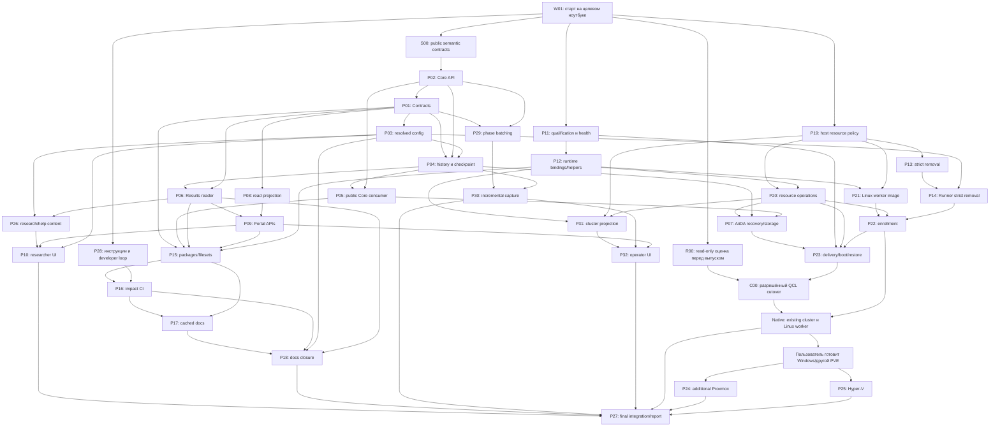

# Исполнительный план Codex: упрощение QCL-NEGF

Дата: 2026-10-27. Статус: **подготовлено для запуска на другом ноутбуке**. Полномочия ниже прямо
предоставлены пользователем в этом обсуждении. Подготовка этого документа не является отчётом о
выполнении 32 PR или изменении сервера.

> Для агента-исполнителя: при наличии использовать `superpowers:subagent-driven-development` для
> независимых задач; `superpowers:executing-plans` — если работу выполняет сам координатор. Эти
> внешние навыки не входят в репозиторий; если их нет, выполнять тот же рабочий цикл по §9 этого
> плана. Чекбоксы — состояние задачи, не новые permission gates.

**Цель:** получить установленную и отлаженную систему с понятным добавлением workers, обновлением
компонентов и исследовательским API; затем вернуться к физике.

**Архитектура:** восемь owning компонентов и существующие изолированные VM;
Core/Runner/Contracts/Results/AiiDA/Platform/Portal/Research общаются через публичные контракты.
Переиспользуются native Nix/systemd/Slurm/backend API, сегментная запись и existing capture. Никаких
campaign CPU quotas и обязательного нового monitoring stack.

**Stack:** Julia, Python, TypeScript/React, NixOS/Nix, Slurm, AiiDA/PostgreSQL, NFS, существующие
Proxmox и будущие Linux/libvirt/Hyper-V worker backends.

**Spec:** [архитектура и решения](project-simplification-2026-10-27.md). Там находится смысл
P01–P32; здесь — полномочия, dispatch, граф и продолжение.

## 1. Явные разрешения и сохраняемые границы

Эта программа заменяет противоречащие ей исторические правила процесса, бюджетов, models/efforts и
сохранения старых результатов. Она не меняет физическую модель, уравнения, scattering,
grids/basis/windows или критерии ради ускорения и не требует отдельного dev кластера.

**Разрешено без повторного запроса внутри программы:**

- Читать и менять исходники/документацию owning компонентов; создавать ветки, commits, публиковать
  component/root PR, автоматически merge после независимого review и необходимых проверок. При
  создании PR прикреплять его к задаче.
- Выполнять нужные builds, tests, synthetic engineering jobs, resource probes, измерения overhead,
  bootstrap/install/update/deploy на QCL ресурсах.
- Останавливать/запускать/перезагружать QCL VM, отменять QCL jobs/workflows, применять hard stop при
  необходимости, менять CPU/RAM и конфигурацию услуг. Для native работ есть один владелец операции,
  known ownership и readback.
- Удалять ненужные QCL результаты, scratch, старые caches/экспериментальные state после описанной
  ниже оценки текущего исследования. Legacy read/migration, архивирование старых массивов и
  сохранение прежнего checkpoint не требуются.
- Исправлять найденные проблемы и продолжать проверку по причине изменения source/failure, не
  просить повторно то же разрешение на каждый шаг.

**Сохраняется:** защита foreign VM/shared non-QCL storage, чужих jobs и unrelated working files;
secrets/private inventories вне public Git; светлый UI; отдельные статусы
process/convergence/physics/discretization/validation; independent oracle. Unknown ownership
блокирует только конкретное разрушающее действие, не всю работу.

Нет искусственного общего лимита времени/CPU/RAM/числа попыток; семь дней — ориентир организации, не
deadline остановки. Использовать доступные owned ресурсы по свежему inventory, согласуя VM/Nix/Julia
parallelism и реальные host reserves. Обычные timeouts управляющих команд, bounded buffers/logs и
stop при нарушении инварианта защищают систему; они не становятся campaign budget или циклом до
pass. Операционный статус объясняет долгую работу, а не молча убивает её по таймеру.

Автоматический merge относится к PR этой программы. Старые открытые PR не сливать оптом: установить
scope/current review и точный source. По возможности сохранять qualified component head при merge;
переписанный commit/новая derivation требует проверки применимости прежнего artifact proof. Root
gitlinks — источник composition; отдельный вручную поддерживаемый SHA lock запрещён.

## 2. R00: оценка текущего суточного исследования перед выпуском

**Место и время:** на целевом ноутбуке при наличии актуального private доступа, непосредственно
перед первым выпуском/действием, прерывающим текущий расчёт. Разработка и независимые проверки не
ждут R00. Старый расчёт не останавливать только ради подготовки этого документа или ночной потери
интернета.

**Новый явный выбор пользователя:** не экспортировать и не сохранять в файловой системе результаты,
научные массивы, history segments или checkpoint старого run. Нужна read-only оценка общих
характеристик и целесообразности **полного запуска заново на новой версии**, а не exact resume
старого checkpoint.

Исполнитель — Sol `xhigh`, независимая проверка вывода — Sol `high` на тех же прочитанных
источниках. Не сообщать ему заранее готовый диагноз.

- [ ] Установить actual run/execution/attempt, worker/Slurm identity, runtime source,
      frozen/resolved model/protocol. Текущий checkout не заменяет run source.
- [ ] Прочитать фактические physics/numerical параметры: структура/материалы, temperature/bias,
      scattering, grids/basis/windows, tolerances/mixing/adaptation; отличить исходные inputs от
      runtime changes и объяснить допустимые изменения.
- [ ] Прочитать доступные компактные ряды за начало/середину/последние этапы и переходы
      attempt/restart: raw SCBA/Poisson residual, mixed step отдельно, current/charge/neutrality,
      finite/causality/spectral/PSD/прочие имеющиеся markers. Использовать штатный read-only API и
      bounded slices, не весь HDF5 в RAM.
- [ ] Проверить резкие скачки/растущие или неограниченные величины, нарушение сохранённых физических
      критериев и признаки plateau/прогресса. Несходимость сама не доказывает ошибку модели; process
      RUNNING не доказывает улучшение.
- [ ] Сообщить в чате/короткой release сводке: что наблюдалось, какие параметры проверены, есть ли
      явное противоречие физике, насколько осмыслен новый полный запуск и почему. Дать qualitative
      time/progress оценку только при данных; обещать сходимость или конечный срок по одному
      несошедшемуся run нельзя.

Выход R00 — **вывод и ограничения**, без архива результатов. В coordinator state достаточно
`assessment=done/unknown`, ссылки на сообщение и решения для cutover. Не сохранять отдельный
dataset/report bundle и не делать отсутствие копии blocker. Исторический CP70/SCI6 от 2026-10-27
06:46:18Z не заменяет свежую оценку. На компьютере подготовки live assessment не выполнена:
актуальный доступ будет на другом ноутбуке в момент выпуска; это известная зависимость native
cutover.

Возможные выводы: продолжение выглядит осмысленным; есть численная/физическая проблема для
отдельного разбора; данных недостаточно. Любой честный вывод закрывает оценку, но negative/unknown
не превращается в scientific pass. Решение остановить старый run для инженерного выпуска уже
разрешено; ждать его научного завершения не требуется. Не устранять подозрение тихой сменой модели.
Новый full SCBA/Poisson run не является synthetic acceptance и не запускается автоматически только
из-за merge/ночного recovery; научный следующий этап явный.

## 3. Первый запуск на целевом ноутбуке — W01

План и связанные инструкции публикуются в ветке `codex/project-simplification-2026-10-27`
репозитория
[Afonenko-QCL-NEGF/qcl-negf](https://github.com/Afonenko-QCL-NEGF/qcl-negf/tree/codex/project-simplification-2026-10-27).
Для нового checkout:

```sh
git clone --branch codex/project-simplification-2026-10-27 --recurse-submodules https://github.com/Afonenko-QCL-NEGF/qcl-negf.git
cd qcl-negf
```

В существующем checkout сначала сохранить unrelated изменения и получить эту ветку; не применять
`reset --hard`/`clean` ради переноса плана. Ветка содержит docs-only overlay поверх опубликованного
candidate `d395044ac09b28c2ff573724f8911d625df43bf5`: его code и gitlinks не меняются публикацией
инструкций. Это стартовый состав для W01, не утверждение об установленном runtime или final release.

Координатор — `gpt-6.1-sol`, effort `high`. Первую адресную inventory/source работу может выполнить
`gpt-6.1-terra high`.

- [ ] Прочитать запрос, этот план, `AGENTS.md`, baseline architecture и нужные owner instructions;
      не читать все исторические журналы перед каждым ticket.
- [ ] Снять `git rev-parse HEAD`, `git status --short`, `git submodule status --recursive`.
      Проверить опубликованный source/PR heads; сохранить unrelated dirty overlay. В этой сессии
      локальный HEAD `93880c23…` старее исследованного candidate `d395044…`; ни один из них не
      объявлять автоматически новым final source.
- [ ] При явном запуске исполнения установить `phase=executing`; подготовка плана оставляет
      `phase=planned`. Разместить execution checkpoint в ignored private generated каталоге
      фактического site. Сохранить только operational state/handoff, не результаты R00.
- [ ] Создать расписания **на этом целевом ноутбуке и в его текущей беседе** по §5. На компьютере
      подготовки активного расписания нет; его thread ID не переносить.
- [ ] Проверить доступность моделей, GitHub/private site и local tools; отсутствие одного входа
      блокирует только зависимый node. Не перебирать произвольные IP/ключи.
- [ ] Назначить готовые независимые задачи; интерфейсный semantic sketch S00 делается до реализации
      зависимых consumers, а не после их расхождения.

## 4. Модели, агенты и владение

| Роль                                                | Модель / effort             | Когда используется                                                                                                |
| --------------------------------------------------- | --------------------------- | ----------------------------------------------------------------------------------------------------------------- |
| Координатор / интегратор                            | `gpt-6.1-sol high`          | Граф, ownership, источники, scheduling, merge/deploy и сводки                                                     |
| Автор сложного state/physics/lifecycle контракта    | `gpt-6.1-sol xhigh`         | Exact checkpoint, Core semantics, memory grant, partial activation/recovery                                       |
| Обычная инженерная реализация и независимый review  | `gpt-6.1-sol high`          | Межмодульные изменения, Nix/CI/API, integration и native проверки                                                 |
| Простая ограниченная операция по готовому контракту | `gpt-6.1-terra medium/high` | Docs/types/fixtures, очевидные migrations, inventory, механические public-API replacements                        |
| Эскалация Terra                                     | `gpt-6.1-sol high/xhigh`    | Если вскрылось новое архитектурное/физическое решение; передать конкретный вопрос/артефакт, не весь проект заново |

Для Terra не назначать effort выше `high`. Default в таблице tickets — `high`; `medium` допустим для
механического переименования/ссылки/малой декларативной правки. Для важных scientific выводов Terra
не единственный reviewer. Изменение этих models явно разрешено пользователем; старое «model не
менять, author ultra, implementation medium» к этой программе не относится.

Один writer на файл/ветку и один владелец lifecycle operation. Готовые задачи разных компонентов
идут параллельно; фактические file conflicts проверяются перед назначением. Разные Git
indexes/worktrees допустимы, новых dev VM нет. Не плодить worktree/агента на каждый command;
сохранять контекст owning задачи. Первый независимый reviewer получает question/assumptions/raw
evidence без готового диагноза. Тривиальной операции не нужен отдельный полный review cycle; review
единица — самостоятельный contract/PR. Платформенная доступная concurrency является технической
возможностью, не новым пользовательским resource budget.

## 5. Расписание, интернет и сводки — только на целевом компьютере

Timezone — **Europe/Minsk**.

| Период                 | Поведение                                                                                                                                                   |
| ---------------------- | ----------------------------------------------------------------------------------------------------------------------------------------------------------- |
| Дневное доступное окно | Продолжать READY nodes и native операции по графу; сводка каждые два часа                                                                                   |
| До 22:00               | Подготовить remote operation IDs, durable checkpoint и следующий READY шаг; заранее получить нужные sources/dependencies, где это оправдано                 |
| 22:00–00:00            | Связь может пропадать. Продолжать по фактической доступности; checkpoint перед/после каждой mutation, detached remote operations с receipts                 |
| 00:00–около 07:00      | Интернет гарантированно отсутствует. Уже запущенные локальные/LAN/remote jobs могут работать без клиента; новые вызовы модели/доставку сообщений не обещать |
| С 07:00                | Повторять проверку соединения, учитывая задержку на несколько минут; затем reconciliation и продолжение, не повтор команды вслепую                          |

Настройка через **Codex heartbeat automation**, не самодельный cron и не отдельные пользовательские
задачи. Создавать только на executing ноутбуке в текущем thread:

1. Основной heartbeat: сводка/продолжение каждые два часа; удобные дневные точки 07:10, 09:10,
   11:10, 13:10, 15:10, 17:10, 19:10, 21:10, 23:10. Вечерний запуск по доступности; недоставленные
   ночные события свести утром.
2. Утренний heartbeat: повторные попытки с 07:00 до 09:00 примерно каждые десять минут. После
   успешного продолжения и при активном координаторе не создавать второго исполнителя/дублирующую
   mutation. Если связь не вернулась к концу окна, основной heartbeat продолжает попытки.

Точные правила recurrence задаются штатным automation tool на месте. Искать существующие matching
automations, обновлять их вместо дубликатов; записать полученные IDs в private operational state.
Нельзя заявлять расписание активным по одному описанию — только по успешному tool result на целевом
компьютере.

В prompt включить: read compact state/handoff → проверить local time/network → reconcile remote
receipts и current source → продолжить READY node → сводка по elapsed двум часам. Если работа уже
выполняется, не запускать второй owner. При `phase=planned` не начинать implementation от фонового
heartbeat; при `phase=executing` продолжать весь уже разрешённый scope без нового approval. При
`phase=complete` сообщить итог и выключить связанные automations.

Сводка: что завершено/опубликовано/слито; активные agents/tasks и models; проведённые checks и
ограничения; состояние VM/jobs; blocker; следующий шаг. После ночи отдельно перечислить, что реально
завершилось без клиента и что осталось неизвестным. Отсутствие связи не равно VM failure. Scheduler
не будит выключенный ноутбук и не гарантирует работу при остановленном приложении; любой следующий
ручной запуск начинает с того же checkpoint/reconciliation. Требование работающего компьютера и
приложения соответствует
[документации Codex Automations](https://developers.openai.com/codex/app/automations).

## 6. Durable продолжение без второго source lock

Private coordination directory: `site/<actual-site>/generated/codex-execution-2026-10-27/`. Если
выбран другой private path, записать его в handoff; исключить обоими Git.

Минимальное состояние: phase, selected root ref, ticket states/dependencies, writer/path ownership,
branch/worktree/PR URLs, active command/session/native operation IDs, last verified receipts, R00
assessment status/message, automation IDs, last report time и next safe action. Никаких credentials
или научных массивов. Gitlinks root определяют component composition; этот state не второй revision
lock.

Сохранять после законченного действия и перед network-dependent mutation, не только раз в два часа.
После reconnect:

- [ ] Сверить remote operation/PID/Slurm/VM/service state и durable receipts.
- [ ] Установить, завершилась ли прежняя операция; outcome_unknown требует readback.
- [ ] Продолжить прежний request/attempt либо создать новый только по установленной причине; не
      перезапускать build/deploy/merge только из-за потерянного ответа.
- [ ] Сверить dirty changes/source/PR head, восстановить ownership и READY nodes.
- [ ] Дать пропущенную сводку и продолжить независимую работу при local blockers.

## 7. Граф работ и cutover

S00 — короткий public semantic sketch: Core exact state/assessment/observations, Contracts
serialized envelope, field ownership/units/status и нужные signatures. Sol `xhigh` фиксирует это
один раз в owning docs/tests; dependent ticket получает точный public API. Пока sketch не готов,
независимые Platform/docs задачи идут.



Стрелки — required contract/evidence, не запрет заранее подготовить fixtures или код зависимого
ticket. P23 code может готовиться до P22 native receipt; native cutover выполняется только с нужным
candidate и R00. Dependency P24/P25 для P27 означает честный measured/pending status, не остановку
всех независимых работ из-за человеческой подготовки одного host. Номера P — IDs, не порядок по
числу.

**C00:** actual ownership/storage inventory → R00 conclusion опубликован → закрыть affected QCL
admission → отменить верхние QCL workflows/retries и jobs, проверить отсутствие повторного enqueue →
необходимые stop/reboot/resize/update/ cleanup → readback mounts/services/source/capacity →
synthetic engineering checks → открыть admission. Результаты старого run можно удалить; их архив не
требуется. Если unrelated resources затронуть нельзя, выбрать иной конкретный путь.

CI/native действия, которые не прерывают и не повреждают старый run, допустимы до R00 с сохранением
его фактических ресурсов. Нельзя подменять это отсутствием оценки перед остановкой самого run, его
VM или удалением его данных.

## 8. Назначение P01–P32

Смысл/приёмка каждой задачи — в spec §7; таблица задаёт owner paths и model. Пути уточнять по
выбранному source при перемещении symbols, не создавать дубликат модуля только из-за старого
locator. Новые signatures из S00 входят в READY card перед назначением consumer, без нового общего
перепланирования.

| Ticket / owner | Model / effort | Файлы и граница                                                                                           |
| -------------- | -------------- | --------------------------------------------------------------------------------------------------------- |
| P01 Contracts  | Sol `xhigh`    | Contracts: src/qcl_negf_contracts/schemas/, public Python validators, generated TS export; contract tests |
| P02 Core       | Sol `xhigh`    | Core: src/QCLNEGF.jl, public state/assessment/observation types; test/domain и test/numerics              |
| P03 Runner     | Sol `high`     | Runner: src/infrastructure/config/configuration.jl и owning configurator/resolution/estimate adapters     |
| P04 Runner     | Sol `xhigh`    | Runner: src/infrastructure/persistence/{scientific_history,point_artifacts,production_state}.jl           |
| P05 Runner     | Terra `high`   | Runner: src/core_api.jl, src/composition/production_workflow.jl                                           |
| P06 Results    | Sol `high`     | Results: src/qcl_negf_results/{live_views,state}.py, owning export/provider API и README                  |
| P07 AiiDA      | Sol `xhigh`    | AiiDA: src/aiida_qcl_negf/{workflow,calculation,parser,research_cards}.py и public service                |
| P08 AiiDA      | Terra `high`   | AiiDA: src/aiida_qcl_negf/service.py, child/attempt selection helpers                                     |
| P09 Portal     | Sol `high`     | Portal: src/qcl_negf_api/{api,service,model_help}.py, frontend/src/api.ts, README                         |
| P10 Portal     | Sol `high`     | Portal: frontend forms/cards/graph/help/plots; public configurator adapters                               |
| P11 Platform   | Sol `xhigh`    | Platform: ops/application_release.py и выделяемые identity/qualification/health modules                   |
| P12 Platform   | Sol `high`     | Platform: modules/application.nix, nix/application.nix, ops bounded commands/runtime descriptor           |
| P13 Platform   | Terra `high`   | Platform: ops/scientific_resource_admission.py и owning strict policy/schema/callsites                    |
| P14 Runner     | Terra `high`   | Runner: strict resource-policy callsites, launcher/composition adapters и configs                         |
| P15 Root       | Sol `high`     | Root: flake.nix, nix/application/source inputs, native package dependency metadata                        |
| P16 Root       | Sol `high`     | Root: ops/ci.ts, .github/workflows/ci.yml, common impact map                                              |
| P17 Root       | Terra `high`   | Root: ops/docs.ts, nix/docs.nix и native cached docs build                                                |
| P18 Root       | Terra `high`   | Root docs index/manuals/mapping; component prose меняется только owning PR                                |
| P19 Platform   | Sol `xhigh`    | Platform: public site/resource policy schema + examples, не private реальные значения                     |
| P20 Platform   | Sol `xhigh`    | Platform: native backend resource adapters, grant/reconciliation и private-policy persistence             |
| P21 Platform   | Sol `high`     | Platform: Linux/libvirt image/profile и worker manual; actual site вне public Git                         |
| P22 Platform   | Sol `high`     | Platform: ops/worker_lifecycle.py, enrollment/DRAIN/smoke/reboot instructions                             |
| P23 Platform   | Sol `xhigh`    | Platform: ops/application_release.py, modules/release.nix, delivery/boot/restore runbooks                 |
| P24 Platform   | Sol `high`     | Platform: Proxmox backend/endpoints/storage/trust и administrator policy                                  |
| P25 Platform   | Sol `high`     | Platform: Hyper-V image/PowerShell/backend и enrollment instructions                                      |
| P26 Research   | Sol `high`     | Research: config/studies/equilibrium-0-70.yaml, protocol/material/source docs; owning help content        |
| P27 Root       | Sol `xhigh`    | Root: опубликованные gitlinks, release composition, installed acceptance report                           |
| P28 Root       | Terra `high`   | Root: AGENTS.md, CONTRIBUTING.md, docs/research-workflow.md, .agents/skills/qcl-*                         |
| P29 Runner     | Sol `high`     | Runner: src/composition/native_phase_telemetry.jl, event sink/sender и sealed phase writer                |
| P30 Results    | Sol `high`     | Results: src/qcl_negf_results/{capture,telemetry}.py и long-run technical reader/report                   |
| P31 Platform   | Sol `high`     | Platform: modules/monitoring.nix, native host/VM status adapters, journal/retention                       |
| P32 Portal     | Terra `high`   | Portal: frontend operational view и bounded public cluster/performance DTO                                |

P13 Terra делает callsite inventory и согласованный removal; новый ресурсный contract определяет
Sol. P10/P26 Sol владеет scientific/help semantics, Terra может делать согласованную UI/prose часть.
P32 Terra реализует готовый bounded DTO/view, Sol проверяет integration/unknown states. Модель не
даёт полномочий менять физику или обходить ownership.

## 9. Исполнение одного owning ticket

Карточка READY содержит: source/ref и dirty overlay, owner и permitted paths, consumes/produces
**точные public signatures/schema**, before/after, failure fixture/oracle, native command из
metadata/CONTRIBUTING, expected result и output artifact/PR. Если public API ещё не определён,
готова design задача S00, а не consumer с угаданной сигнатурой. Это работа координатора/owner, не
новый вопрос пользователю о рутинной реализации.

- [ ] Прочитать только relevant contract/source/tests; подтвердить, что finding ещё существует. Уже
      исправленный дефект не восстанавливать ради ticket.
- [ ] Сформировать различающий behavioural check для code change; docs/format правка использует
      соответствующую проверку без scientific environment.
- [ ] Реализовать owning change и common helpers внутри правильного owner, удалить заменённый ad-hoc
      путь; не протащить private cross-package access.
- [ ] Выполнить targeted checks, проверить diff/docs/API/type compatibility; сохранить фактически
      выполненные проверки и ограничения.
- [ ] Независимый review meaningful PR; исправить замечания и повторить только
      затронутые/непрошедшие проверки. Подтверждать success по свежему output.
- [ ] Опубликовать и прикрепить PR, merge при принятом review и нужных checks; root обновляет
      опубликованный gitlink. Сначала assemble candidate из exact published heads, если native
      проверка требует совместной композиции.
- [ ] Обновить DAG/state/handoff и выбрать следующий READY node.

Не объявлять все gates пройденными по pytest/exit code/Nix eval. Отдельны: source publication,
engineering build, trust/staging, guest service, backend boot, synthetic job/cancel/fault/recovery,
restore, final source CI и scientific acceptance. Повторный full CI нужен после затрагивающего
source изменения/открытого failure, а не автоматически 32 раза по числу PR. Artifact qualification
переиспользуется только при совпадении identity/contract/environment; новый root HEAD не наследует
старую full-release приёмку.

## 10. Review focus и различающие сценарии

| Риск                                                                         | Owning tasks        | Что именно проверить                                                                                                      |
| ---------------------------------------------------------------------------- | ------------------- | ------------------------------------------------------------------------------------------------------------------------- |
| Нет live оценки, старый report выдан за текущее состояние                    | R00/C00             | Run/source/attempt/time identity; вывод по фактическим данным до interruption, missing явно                               |
| Checkpoint/cursor опубликован без зависимостей либо повторённые шаги склеены | P01/P04/P06/P29/P30 | Crash до/после publication barriers, orphan/duplicate/cutoff, новые bytes без полного prefix replay                       |
| Idle balloon RAM блокирует запрос либо host overcommit убивает VM            | P19/P20/P22         | Request до guest reject, actual readback, active grant, Slurm registration/fallback, retained failure reason              |
| Частичное обновление/старый helper/network timeout открывает admission       | P11/P12/P23         | Old capability до mutation, disconnected client, uncertain result/reconcile, late NFS/boot order                          |
| Technical collector влияет на solver или потеря данных названа нулём         | P29/P30/P31/P32     | Collector unavailable/buffer pressure, raw scientific rows не drop, coverage/unknown/self-cost и same-workload comparison |

## 11. Этапы и завершение

Ориентир прежней недели остаётся как порядок результатов, не ограничение:

1. W01/S00/P28 и независимые P11/P19; короткий developer loop и точные contracts.
2. Scientific state/history/reader и performance capture; параллельно resource/ delivery helpers,
   package filesets, cards/help и CI/docs.
3. R00 перед первым disruptive выпуском; existing cluster + дополнительный Linux/libvirt worker,
   своевременные native checks, затем scoped rollout, fault/restore/browser/performance acceptance.
4. После Linux этапа пользователь готовит Windows/другой PVE; проверить их независимо. Доступность
   этих hosts — человеческая зависимость, не выдуманный pass.
5. P27: final ready composition, impacted CI, установленный release, русские руководства и список
   measured/pending outcomes. Снять automations после complete; stale planned tasks не оставлять как
   скрытое обещание.

Готовность означает отлаженный установленный продукт с проверенным рабочим путём, а не только merged
PR. Все решения о данных/моделях, где не хватает научных оснований, обозначаются отдельно. Научный
следующий запуск получает вывод R00 и сохранённую постановку из source, а не старые массивы.

## 12. Стартовое сообщение Codex на другом ноутбуке

Начни исполнение этого плана. Применяй явно предоставленные здесь полномочия, модели и effort; не
вводи общие resource/time/attempt budgets. Сначала W01: source/status/gitlinks, actual private site
и расписания на текущем компьютере. Параллельно готовь S00/P28/P11/P19 с одним writer на path. При
выпуске до остановки текущего долгого run выполни R00 read-only оценку без экспорта/архива
результатов. Связанные PR разрешено открывать и merge после review/checks; QCL VM/jobs/results
разрешено останавливать/менять/очищать после оценки. Продолжай READY задачи до установленного
результата, сообщай сводку каждые два часа при доступной связи. Перед риском обрыва с 22:00 сохраняй
checkpoint, после восстановления около 07:00 сверяй фактический исход операций и продолжай без
дубликатов. Используй архитектурную spec только в нужном разделе.

## 13. Проверяемые утверждения

| Утверждение                                         | Свидетельство                                         | Ограничение                                          | Решение                |
| --------------------------------------------------- | ----------------------------------------------------- | ---------------------------------------------------- | ---------------------- |
| Операционные полномочия и automerge предоставлены   | Прямые ответы пользователя от 2026-10-27              | Только scope QCL/этой программы                      | сохранить              |
| Старый run должен быть архивирован                  | Пользователь прямо отменил сохранение его результатов | Нужна read-only оценка перед interruption            | изменить               |
| Текущий run уже проверен на физическую расходимость | На компьютере подготовки live данных нет              | R00 выполняется на другом ноутбуке при выпуске       | данных недостаточно    |
| Расписание уже действует на целевом компьютере      | Подготовлены инструкции, здесь automation удалена     | Требуется успешная установка W01 на целевом ноутбуке | данных недостаточно    |
| Целевой релиз уже установлен                        | Этот документ — план, code/native stages не выполнены | Итог проверяется P27                                 | дополнительно измерить |
