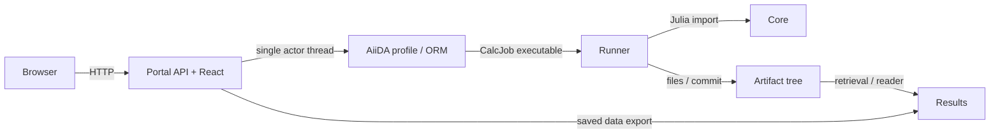

# RV03 — actual source views

Candidate, source review 2026-10-14; [capsule](cards/RV03-scope.md), [S](source-receipt.json).
Writer coordinator; независимый reviewer pending. Четыре пакета: dependency/import,
context/container, job/data/release и deployment/storage. Denominator — 12 edges ниже,
не весь возможный dynamic graph. Остальные edges остаются partial; live topology не измерена.
Корневой `docs/architecture.md` и target `docs/system/architecture.md` — frozen hashes из receipt.
Все пути далее repository-relative; точные owning commits взяты из Git gitlinks S.

## Dependency/import — 6 declared edges

| Edge / owner | Producer side | Consumer side / mutable state | Verdict |
| --- | --- | --- | --- |
| Runner→Core / Core,Runner | Core `3108150…:src/QCLNEGF.jl` exports/modules | Runner `0c53c6d…:Project.toml`, `src/QCLNEGFRunner.jl` import QCLNEGF, `src/core_api.jl` explicit bindings | source dependency подтверждена; отдельные imported runtime refs unknown |
| Results→Contracts / Contracts | `923e0c6…:src/qcl_negf_contracts/artifacts.py` | Results `fe27a2a…:pyproject.toml`, `src/qcl_negf_results/model.py` imports MODEL_SCHEMA/require_contract_set | source подтверждён; reader canonical identity distinct from Julia numerical oracle |
| AiiDA→Contracts / Contracts | schemas/artifacts API | AiiDA `69aa130…:pyproject.toml`, `src/aiida_qcl_negf/validation.py` | package/source boundary, не solver dependency |
| Portal→AiiDA / AiiDA | `src/aiida_qcl_negf/service.py::open_artifact/submit_plan` | Portal `10b6c87…:service.py::_initialize/_call`, dynamic import `aiida_qcl_negf.service` | runtime interface via actor, ORM state belongs owner thread |
| Portal→Results / Results | `src/qcl_negf_results/export.py::export_snapshot` | Portal `exports.py::_prepare` local import export_snapshot | export computation/source copy and spool belongs Portal; format reader belongs Results |
| Root→selected components / Root | `e48e5b2…:ops/git.ts::gitlinks/sourceGraph` parses HEAD Git gitlinks | `ops/environment.ts::sync/lock` workspace/native metadata | identity composition derived from Git; lock != execution evidence |

Наблюдение: Core imports LinearAlgebra/Logging/SHA/FFTW/Unitful/Roots; в просмотренном
`src/QCLNEGF.jl` нет Runner import. Это локальный entrypoint witness, не полный forbidden-edge scan.
Runner native `[sources]` выбирает Core tag v0.2.0, workspace выбирает checked-out Core:
одинаковая package version сама не связывает два источника. Расширение closure — RV14.

## Context/container — 2 edges

Diagram — bounded source view; Browser auth/serving details и artifact lifecycle имеют своих владельцев.

| Edge | Обе стороны source | Owner/state / limitation |
| --- | --- | --- |
| Browser→Portal | Portal `frontend/src/api.ts::api` fetches /api/v1; `api.py::create_app` routes + StaticFiles mount; `hatch_build.py::CustomBuildHook` owns static payload | API/React один package, отдельные процессы браузер/server; native serving не проверен |
| Actor→AiiDA state/handles | Portal `service.py::AiidaService` max_workers=1, `_initialize` event loop/load_profile, `open_artifact/close`; AiiDA `service.py::open_artifact` repository context | profile/ORM/handle ownership заявлен и source подтверждён; unbounded Future.result responsiveness уходит в RV05 |

Repo boundary не равна process boundary: Portal runtime imports AiiDA и Results;
Core/Runner separate packages могут жить в одном Julia process. Root не runtime service.
Target boundaries frozen architecture совпадают с этими owners; полнота target функций не установлена.

## Job/data/release — 2 edges

| Edge | Producer / consumer locator | Interface и state |
| --- | --- | --- |
| AiiDA→Runner executable | AiiDA `calculation.py::QCLExecutionCalculation.prepare_for_submission` builds CodeInfo/arguments, one threaded process and immutable plan selection; Runner `src/cli.jl::_cli_heavy` run-plan branch→`execute_scientific_plan_staged` is exact CLI consumer | frozen plan/execution/attempt; no MPI; Slurm owns resources. CLI dispatch проверен, staged→Core full call trace здесь partial, RV04/12 продолжат |
| Runner artifacts→retrieved AiiDA/Results | Runner `src/infrastructure/runtime/filesystem_repository.jl::save_runtime_checkpoint!`, `src/infrastructure/persistence/point_artifacts.jl::commit_point_artifacts`; AiiDA `calculation.py` retrieve_list result/series_result.json/scientific_plan.json/recovery/executions; Results `native.py::validate_native_handle`, `multipart.py::receive` | Runner writes generations/commits; AiiDA records retrieved provenance; Results independently checks structure/identity, не process exit science pass |

Release не сливается с job: AiiDA `calculation.py` optional release_id проверяет InstalledCode
Nix path и prepends `qcl-negf-release guard`; root selected Git graph отдельно. Saved installed overlay
RV01 относится к `qcl-5d779b52-s01-20261012`, не автоматически к S source/imports.
Atomic publication/unknown submit/retry assertions адресно проверяются RV11/RV12.

## Deployment/storage — 2 edges

| Edge | Source producer/consumer | State и limitation |
| --- | --- | --- |
| Platform application closure→Portal/AiiDA | Platform `4ce214e…:flake.nix::lib.mkPythonEnvironment`→`nix/application.nix` loads workspace, includes members, copies frontend into static; `modules/application.nix` PostgreSQL/profile/API units; Portal api.py StaticFiles | builds install immutable code/assets; mutable DB/repository отдельно. Реальный nginx/systemd install неизвестен |
| Storage/controller/worker state owners | Platform `modules/storage.nix` NFS export; `modules/cluster.nix` controller/worker/submit and jobDirectory/scratchDevice; `modules/persistent-state.nix` bind AiiDA state + PostgreSQL/slurm under separate disk | NFS exchange != backup; scratch != retrieved archive; PostgreSQL+repository one logical restore generation. Device formatting requires explicit initializeBlankDisk; this review changes nothing |

CI/controller/storage/compute — target role model; публичный flake экспортирует modules/mkImages,
реальные roles/inventory и observed drift не выводятся из defaults. RV13 задаёт public restore scope.
Базовый build/include граф DAG не исключает data/dynamic cycle через artefacts и recovery.

## Alternatives и сохранённые границы

Наблюдение: owners выбранных edges соответствуют root baseline. Вывод: нет source основания
создать новый coordination service либо переносить scientific acceptance в UI. Предложение:
сохранить boundaries; улучшения делать локальными owning tickets RV05/07/11/14.
Counterexample для «объединить Core/Runner»: перенос filesystem persistence в numerical Core
делает библиотеку зависимой от execution infrastructure; это смена архитектурного contract,
не эквивалентная numerical optimization. Цена сохранения: адаптеры/API нужно документировать.

Административное coverage: 12/12 declared edges имеют local source locators.
M06 identity closure (source→build→import/runtime) not_measured; это не12/12 identity pass.
M12: full SCC/fanout graph not_measured, утверждение отсутствия всех cycles не делается.
Исследователь получает owner формул и raw данных; оператор — state/storage/release отличия;
разработчик — направленные interfaces и конкретные owning компоненты.

| Утверждение | Свидетельство | Ограничение | Решение |
| --- | --- | --- | --- |
| Actual source содержит четыре разных views | 12 bounded edges / обе стороны | full dynamic/process graph partial | сохранить |
| Runtime совпадает с selected source | RV01 release identity != Git import proof | imported metadata отсутствует | данных недостаточно |
| Persistence/acceptance не следует переносить в Core/UI | frozen AGENTS + source owners | отдельные contract defects проверяются другими RV | сохранить |
| Closure/restore требуется измерять отдельно | source manifests/units/reader contracts | build/native restore не запускались | дополнительно измерить |
