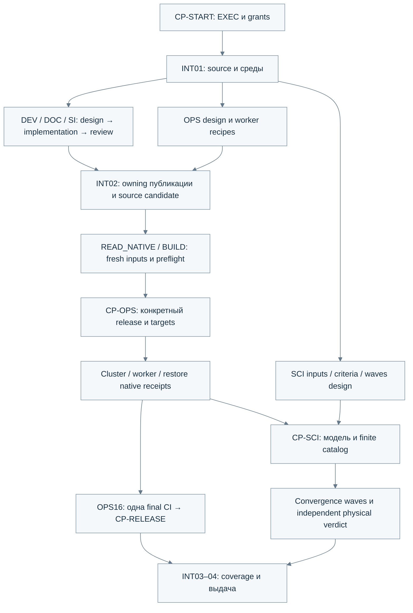

# QCL-NEGF: детальный план автономной разработки в Codex

> **For agentic workers:** будущая реализация — через
> `superpowers:subagent-driven-development` либо выбранный оператором
> `superpowers:executing-plans`, по checkbox tasks. Сейчас **только PLAN**.

**Goal:** отработать все findings RV00–RV19/SI01–SI07, получить принятый
подключённый кластер и проверенный worker distribution с инструкцией, затем
провести convergence studies и обоснованную попытку physical acceptance.

**Architecture:** existing восемь owning components сохраняются. Координатор
Sol выдаёт независимые конечные tasks, design `ultra` отделён от implementation
`medium`, review `high` проверяет exact candidates. Existing Git/AiiDA/Slurm/
Runner/Results владеют своими identities; новый orchestration service не нужен.

**Tech Stack:** Julia Core/Runner и root Manifest; Python 3.14/uv.lock;
FastAPI/React/Node locks; NixOS/Nix/OpenTofu/Slurm/AiiDA; Documenter и owning docs.
Tools/versions проверяются по фактическому выбранному source перед исполнением.

**Spec:** поручения пользователя от 2026-10-19 о полном объёме и высокой
автономности, с последующим ограничением текущего этапа планированием;
[implemented architecture](../../architecture.md),
[review programme](../../system/comprehensive-review.md),
[historical requirements](../../system/requirements.md), immutable review bundle.
Текущий документ — единственная точка входа этого handoff; он не заменяет
научные контракты компонентов и не разрешает execution.

## Global constraints

- Текущее поручение — документы плана и их отдельный docs-only PR, включая
  public historical review. Product code/config/AGENTS, imports/install/build,
  server и scientific execution не выполняются; merge этого PR не поручен.
- Latest operator instruction сильнее старого grants/плана. PLAN переходит
  в EXEC только по отдельному CP-START.
- Выбранная Sol сохраняется; actual ID/effort capability фиксируются при запуске.
  Canonical распределение `medium/high/ultra` — из roadmap; fallback не молчаливый.
- Git gitlinks — состав. Не latest всех компонентов и не второй maintained SHA lock.
- Не ослаблять physics/scattering/discretization/acceptance ради pass или RAM.
  Заранее разрешённые numerical variants SCI имеют новые plan identities.
- Process, convergence, physics, discretization, validation и transport integrity
  имеют отдельные outcomes; missing/not_measured не pass.
- Raw arrays/failed attempts/provenance сохраняются; secrets/private inventory,
  depots и scientific arrays в Git не включаются.
- Все web surfaces фиксированно светлые; auto-dark и dark alternative не вводятся.
- Foreign VM/jobs/reserves защищены. Source plan не является wipe/cancel/deploy grant.
- CI выполняется один раз на final ready source ref; automatic reruns не вводятся.
- Один writer на owning file/ветку; independent reviewer получает immutable inputs.

## Review focus

1. Смена published attempt во время экспорта: один immutable CalcJob для всех
   данных/плана/статуса/cache; DEV09–11.
2. Ошибка после remote mutation/submit: unknown outcome, reconciliation и
   отсутствие duplicate; DEV12–13/23, OPS02–03/08/14.
3. Partial durability/недостаток recovery storage: old/new verified generation,
   independent reader, immutable pre-prune reserve; DEV17–18, OPS10, SCI07.
4. Stale source/assets/build/import и перенос старого pass: route-specific
   identity/controls; DEV19–22, OPS04–06/16, DOC04–06.
5. Ложная physical acceptance по seed/нормировке/малому mixed step/двум
   несошедшимся states: independent oracle, raw/fresh final U/G и error budget;
   DEV02–08, SCI03–04/10–15.

## Комплект handoff и правила чтения

| Документ | Назначение | Tasks |
| --- | --- | --- |
| [Autonomy](autonomy.md) | Sol roles, permissions, technical/operator checkpoints, retry/resume | Общий контракт всех tasks |
| [Operator permissions P1](operator-permissions.md) | Утверждённые B/G1/S1 без e–e, conditional grants и поздняя привязка | approved_standby; EXEC не активирован |
| [Development](development.md) | Точные software interfaces, paths, tests/controls и envelopes | DEV01–25 |
| [Platform/worker](platform-worker.md) | Owner lifecycle, native build/cluster, три backend и выдаваемый артефакт | OPS01–17 |
| [Science](science.md) | Source/model/criteria, bounded waves, raw analysis и physical attempt | SCI01–15 |
| [Documentation/instructions](documentation-instructions.md) | Requirements, reader routes, light/offline docs, SI01–07 | DOC01–07, SI01–07 |
| [Coverage](coverage.md) | RV/SI → tasks, evidence level и остаток | Все направления + integration |
| [Старт новой сессии](start-new-session.md) | Синхронизация Git и сообщение активации от человека | CP-START/INT01, не автоматический EXEC от чтения файла |
| [Primary review](../comprehensive-review/2026-10-14-e48e5b2-01/index.md) / [Portability](../comprehensive-review/2026-10-14-e48e5b2-01/PORTABILITY.md) | 148 original files, frozen-root overlays и publication receipt в Git | Исторические свидетельства, не новая приёмка |

Сначала прочитать README и autonomy, затем только выбранную task и её inputs.
Полный архив и все документы не перечитываются перед каждым маленьким ticket.
Комплект публикуется отдельной веткой `codex/review-closure-handoff` от source
`codex/comprehensive-review-program`. До merge нужно синхронизировать именно
head этого docs PR, не более старый main. Handoff и public review входят в Git;
старый чат, original local bundle и `/tmp` не являются обязательными inputs.
Инструменты одинаковы по условию пользователя: краткий INT01 подтверждает
фактический source/environment, затем сразу начинается ready task.

## Источники и сегодняшнее состояние

Срез подготовки: root `93880c23bca889ddcb8b98edb995080b332dd99f`, eight gitlinks
проверены. Архив review — `2026-10-14-e48e5b2-01`, другой source и отдельные
runtime/attempt identities. **A** — published repository-relative каталог
`docs/implementation/comprehensive-review/2026-10-14-e48e5b2-01/`, не обязательный
external `REVIEW_BUNDLE_DIR`. Его publication receipt сохраняет original hashes;
PORTABILITY описывает frozen overlays и unavailable originals. Missing private
native/scientific inputs блокируют только dependent claims/операции; доступны
все original report/fixcard inputs для source tasks.

Сервер недоступен. Пользователь сообщил, что после ревью работ на нём не было.
Это не устанавливает live queues, terminal outcome старого S01 или fresh admission.
Старый private site выбирает исторический source; private inputs проверяются
только после READ_NATIVE. Новых серверных probes в подготовке handoff нет.

До уточнения PLAN в отдельной копии были черновые правки; все 15 tracked files
восстановлены, commits/push/server/solver не выполнялись. Эти patches и ранние
тестовые результаты не принимаются как готовая реализация или доказательство.
Сегодняшний handoff изменяет только перечисленные Markdown-документы.

## Уровни усилий и деление работы

| Работа | Sol effort | Когда менять роль |
| --- | --- | --- |
| Координация, source/resource audit, scientific analysis | `high` | Новый проектный вопрос выделить D-task |
| Interface/architecture/scientific criteria, authored docs | `ultra` | После CP-DESIGN передать implementation |
| Готовая совместимая реализация и заданные fixtures | `medium` | Неясная семантика → design, не implementation guessing |
| Независимый code/science/операторский evidence review | `high` | Не становиться вторым writer того же candidate |

Модель не выбирается заново для каждого task. Уровни задаются явно при spawn,
не зависят от длительности CPU job и не расширяют permissions.
Все внутренние CP-DESIGN/CODE/SOURCE/NATIVE/RELEASE/SCI-RESULT проходят без
переспрашивания оператора, если active grants и принятые invariants сохранены.
Операторские CP-START/OPS/SCI/EXCEPTION описаны в autonomy; молчание не approval.

## Очерёдность и критические зависимости

Диаграмма — общий путь выпуска. Exploratory SCI по объявленному immutable
existing CLI/runtime может начаться раньше нерелевантных GUI/Windows/full
software closure, если его собственные source/oracle/criteria/admission gates
закрыты и CP-SCI это разрешает. Он не заменяет cold/full release acceptance.

Параллельная начальная очередь после INT01: DEV01, DEV02, DEV09, DEV12,
DEV14, DEV17, DEV19, OPS02/07 design, SCI02–04 design и DOC01/SI01–02.
Конкретные зависимости карточки сильнее этой ориентировочной очереди.
Ни одна task не конкурирует за тот же file writer; интеграция Portal/Runner/
Platform сериализуется. Native concurrency определяется общей memory/I/O admission.

## INT01 — старт, доступность источников и подготовка сред

**Owner/role:** coordinator/audit `high`; bounded environment preparation I
`medium` по accepted locks. **Grants:** DEV; READ_NATIVE/BUILD только для назначенного
host/stage. **Paths:** coordination/evidence вне scientific arrays; existing
`julia/{Project,Manifest}.toml`, `uv.lock`, component lockfiles read-only;
isolated environments в approved worktree/private cache. Не менять locks «для запуска».

- [ ] Зафиксировать последнее operator instruction, active grants/model/capability,
  scope source и handoff availability. Проверить actual HEAD/status/submodules,
  preserve unrelated changes и original archive. Никаких resets/latest updates.
- [ ] Сформировать один coordination checkpoint и task ownership/readiness map.
  Состав получить из Git, не ручного revision list.
- [ ] Установить available runtimes и resource headroom. Проверить actual imports
  из owning paths; не использовать cached чужой editable import как доказательство.
- [ ] Подготовить минимальные locked Python/Node targeted среды внутри DEV
  envelope, если этот grant включает setup. Полный Julia/depot/native toolchain
  готовится отдельным BUILD после admission; отсутствие среды не лечится stubs.
- [ ] Для каждого env записать executable/version/lock/source route, память,
  install output и ограничения. Не писать secrets/private data в public receipt.

**Envelope:** proposed setup packet до 30 минут и двух попыток с разными
диагнозами; CPU/RAM/storage по измеренному host. Targeted L-PY/L-JL limits из
DEV не умножаются на agents. Cold setup не считается временем algorithm benchmark.
**Exit:** CP-SOURCE, готовые subset tasks и точные env blockers. **Stop:** missing
access только dependent host; unsupported Sol capability только affected role.

## INT02 — owning refs, PR и интеграционный candidate

**Owner/role:** I `medium`, independent R `high`; **deps:** CP-CODE каждого
публикуемого component; **grants:** PUBLISH, MERGE_G1 при merge. **Paths:** owning commits/PR descriptions,
root gitlinks/native generated locks и sanitized source receipts.

- [ ] Для component подготовить focused commit/PR с exact problem, preserved
  compatibility, checks и ограничениями. Existing Results PR6 продолжить;
  его current base/head/diff проверить, не создать duplicate.
- [ ] Push только разрешённые feature refs; attach created/continued PR к task
  штатным инструментом. Не отправлять сообщения в другие чаты/сервисы.
- [ ] Root выбирает опубликованные owning commits через gitlinks; locks меняются
  native resolver только при реальном изменении зависимостей и принятом contract.
- [ ] Сохранить root candidate ref, source/dirty/build receipts. G1 разрешает
  merge после independent review/required checks/protections; draft PUBLISH сам
  merge не разрешает. Final source identity сохраняется для sole final CI;
  public release и merge вне G1 требуют отдельного решения.

**Exit:** reachable source candidate, повторный CP-SOURCE и готовность inputs
для CP-NATIVE/BUILD. Final CP-RELEASE наступает после native receipts и OPS16,
не блокирует публикацию owning candidate. Один package version не заменяет
contents/native contract.
**Stop:** unavailable credentials/ref или out-of-scope shared mutation.

## INT03 — независимое полное сопоставление с планом

**Owner/role:** independent reviewers `high`, coordinator `high`.
**Deps:** delivered software/docs/native/science receipts; missing required
results остаются явно blocked. **Grants:** read/check scope по доступным artifacts.

- [ ] Заполнить coverage RV00–19/SI01–07: task/decision/receipt/limits; не считать
  количество файлов, агентов, checks или checkbox scientific evidence.
- [ ] Разделить source assertions, fixture outcomes, native/runtime measurements,
  solution verification и experimental validation.
- [ ] Проверить exact-source applicability completed checks после integration;
  не запускать всё повторно без source change/unresolved risk. Final CI — OPS16,
  один раз на final ready ref, с original failure и без automatic rerun.
- [ ] Сверить пять Review focus выше, operator grants/bindings и scope changes.

**Exit:** independent same-source assessment и точный remaining list; required
blocker не закрывается ruling «достаточно». **Stop:** inconsistent/missing evidence
локализуется, исходные arrays/logs не переписываются.

## INT04 — выдача оператору и воспроизводимое продолжение

**Owner/role:** документация D `ultra`, evidence review R `high`.
**Deps:** INT03, OPS15/17, SCI15. **Grant:** DEV/PUBLISH/OPS по месту выдачи;
public release отдельно. **Outputs:** operator handoff, worker artifact manifest,
install/update/rollback guide, release/source refs, scientific report, checkpoint.

- [ ] Передать артефакт в разрешённое место с hash/manifest, tested backend list,
  prerequisites, disk/trust warnings и walkthrough до первого job.
- [ ] Показать current cluster/release/admission и restore receipts, без private
  credentials. Native unverified backend обозначить явно.
- [ ] Выдать научный report: что получилось, что не сошлось/не принято, причины,
  uncertainty/ограничения и минимальное следующее свидетельство.
- [ ] Сохранить active IDs/unknown outcomes/next tasks и exact resume instructions.
  Отрицательная scientific attempt не называется достигнутой physical acceptance.

**Exit:** CP-END по отдельным результатам. Полный release остаётся partial при
required backend/cluster/evidence gap; пользователь видит конкретный остаток.

## Что остаётся решить оператору перед исполнением

1. Отдельной командой активировать EXEC и согласованные B/G1/S1; сохранить выбранный Sol
   или назвать exact ID, если его нельзя определить из текущего клиента.
2. Если нет доступного trusted access/private inventory/назначенного pool,
   предоставить эти входы. Внутри B CP-OPS BIND с source/hash/targets/window/
   backup/rollback закрывают coordinator+reviewer, без нового human approval.
3. S1 без e–e уже принят: CP-SCI READY закрывается по justified frozen criteria,
   finite catalog, guards и fresh admission. Неизвестный bound не становится pass.
4. Destructive/merge/trust/model exceptions вне B/G1/S1 и public release —
   конкретное решение по evidence; глобального неявного разрешения нет.

Эти remaining inputs/exceptions не отменяют принятые grants и не запускают работу.
Отсутствие финансового compute cap уже учтено; его не нужно подтверждать на
каждом тесте/attempt. Реальные admission и finite stop/outputs обязательны.

## Приёмка самого handoff

- [x] Все 75 task IDs уникальны: 25 DEV + 17 OPS + 15 SCI + 7 DOC + 7 SI + 4 INT.
- [x] Каждый RV00–19/SI01–07 имеет mapping, owner и проверяемый выход.
- [x] References/paths/commands отмечены existing/proposed и проверены по source;
  ни одна future command не названа выполненной.
- [x] Grants/checkpoints едины, design/implementation/review разделены,
  нет silent mode transition или обязательного human approval каждого ticket.
- [x] Source status содержит только документы handoff; продуктовые компоненты чистые.

Первоначальная проверка текста от **2026-10-19**: 75/75 уникальных task definitions, 28/28
original fixcard filenames без пропусков, 43 local file/anchor links, balanced
code fences, final newlines и отсутствие trailing whitespace. Это static checks
документов, не product tests. Независимо проверены completeness и autonomy,
затем выполнен focused reread изменённых gates. Исправлены циклы preparation/
CP-OPS, build/final-CP-RELEASE и artifact/backend/shutdown; read-only reviewer
не получает publication duties. Counts и согласие reviewers не доказывают
физику или native execution.

P1 содержит 18 permission entries. Пользователь **2026-10-19** явно утвердил
**B**, **G1** и **S1 без электрон-электронного рассеяния**; точные ответы и locator
в P1 decision table. Статус approved_standby, отдельного EXEC ещё нет.
Пакет прошёл независимый read-only review; measured-only RTO в принятом B
заменяет prerequisite numeric SLA в OPS10. S1 сохраняет baseline e–e none и
все пять остальных механизмов; число75 implementation tasks не изменилось.

Source подготовки — `93880c23`; docs-only PR добавляет отдельный root commit,
сохраняя восемь gitlinks/component worktrees. В PR входят handoff и public
historical review; original bundle в основной копии сохранён. Product tests/
imports, installs/builds, CI, server probes и solver runs здесь не выполнялись.

| Утверждение | Свидетельство | Ограничение | Решение |
| --- | --- | --- | --- |
| Полный объём разбит на исполнимые пакеты | DEV/OPS/SCI/DOC/SI/INT карточки | Реализация сегодня не начинается | сохранить |
| B/G1/S1 без e–e согласованы | P1 decision table, autonomy BIND/READY/resume | approved_standby; EXEC не активирован | сохранить |
| Cluster/distribution/physical acceptance доказаны | Только план и source reading | Native/scientific execution отсутствует | дополнительно измерить |
