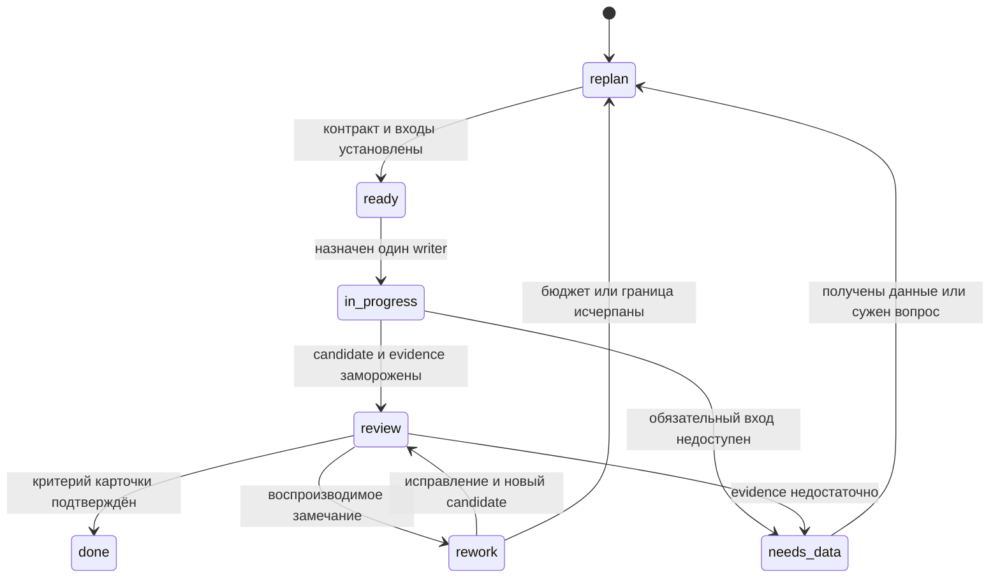

# Автономный рабочий цикл review → refactor

Статус: проект декомпозиции текущего session task, 2026-10-14. Сейчас разрешены
составление общего review, чтение источников и подготовка документации.
Карточки ниже готовы к ограниченному аудиту; реализация, новые scientific runs,
полные tests/CI, установка окружения и серверные действия этим текстом не поручены.

[Полный автономный план](autonomous-review-plan.md) раскрывает все RV и SI,
порядок назначения пакетов и checkpoint. Четыре карточки ниже сохраняются как
начальные срезы; лимиты полного прохода назначаются по выбранному плану,
а не складываются с прежним предложением бюджета этих четырёх карточек.

Цель — получить достаточно подробные задания, чтобы агенты самостоятельно
переходили от вопроса к проверяемому решению в уже разрешённом scope. Четыре
результата равноправны: формализация текущих требований, документация, code review
с обоснованными изменениями и научная приёмка с честными границами доказательства.
Исследователь, оператор и разработчик также равноправны. Приоритет конкретного
задания определяется риском и готовностью зависимостей; числовая квота работ
не выражает это равенство.

## Единица работы и источники

Единица работы связывает четыре потока вокруг одного вопроса или поведения:
актуальная цель и предпосылки → проверка кода, интерфейсов, документации и
свидетельств → обоснованный design с владельцем → ограниченное изменение
в будущем разрешённом этапе → независимое review и исправление → owner PR →
опубликованный gitlink и повторная release-проверка, когда они поручены.
Документационная задача может закончиться уточнением смысла API; научная —
выводом «данных недостаточно». Оба выхода полезны без изменения solver.

Все четыре потока начинают работу параллельно, когда готовы их собственные
входы. Научная приёмка не становится единственным gate любого документационного
или инженерного изменения. Общая документация не является обязательным
предшественником чтения готового результата или отдельно порученного solve.
Зависимости задаются конкретным требуемым выходом: например, проверка source
identity предшествует переносу старого test receipt, а архивная identity —
интерпретации сохранённого набора.

Текущий запрос пользователя определяет цель и полномочия. Исторические статусы
«С/Н/П», старые чаты, roadmap и [программа review](comprehensive-review.md)
дают перечень утверждений для перепроверки. Они сами по себе не доказывают
нынешние пожелания пользователя. Физические source files описывают реализованные
предпосылки, а не предписывают пользователю следующую постановку.

На каждый пакет фиксируются root ref, gitlinks, dirty overlay и первичные
артефакты. Для текущего пакета root —
`e48e5b2ef16d3e6f1d633dd29c95f94d60ca8cc1`; изменения root docs отдельно от HEAD.
Состав выводится из Git, без второго вручную поддерживаемого revision lock:

```console
git rev-parse HEAD
git status --short
git submodule status --recursive
git ls-tree e48e5b2ef16d3e6f1d633dd29c95f94d60ca8cc1 components/
```

Reader получает commit + path/symbol, artifact SHA256 + dataset/selection либо
hash frozen текста. Архивный source, publication branch, установленный runtime
и candidate PR разделяются. Совпадение версии пакета не заменяет source binding.
Изменение входа создаёт новую ревизию карточки и новый review round.

## Разбиение до READY

Draft может содержать пробелы. Координатор разбивает его, пока каждая атомарная
карточка содержит следующие поля.

| Поле | Что должно быть однозначно |
| --- | --- |
| Вопрос, роль и owner | Одно поведение или утверждение; пользу для трёх ролей либо обоснованную неприменимость; owning repository и исполнитель |
| Входы | Неизменяемые source/data refs, пути и hashes; publication branch/PR, если существует; доступность обязательных входов |
| Граница | Разрешённые действия и paths, исключённые соседние изменения; один writer на файл/ветку без перекрытия |
| Invariants | Сохраняемые model, units, grids/basis, tolerances, statuses, identity и durability по применимости |
| Oracle и acceptance | Проверяемое свойство, независимый источник, positive и negative case; применимость, нормировка и ограничения |
| Проверка | Точные команды с окружением или явный протокол чтения; стоимость каждой проверки и предел mocks |
| Зависимости | Конкретные outputs предшественников; задачи, которые можно начать параллельно |
| Бюджет и остановка | Общий конечный предел пакета; действия при исчерпании, несовпадении identity или выходе за scope |
| Выход | Finding/design/patch/report, его путь, воспроизводимые локаторы и допустимый уровень заключения |

READY означает отсутствие блокирующего неизвестного в контракте задания,
а не заранее известный ответ. Карточка «установить, какие raw данные отсутствуют»
готова, если доступен ограниченный inventory. Карточка «доказать FDR на final
матрицах» требует самих матриц и соответствующих identity до READY.

Если locator устарел, агент ищет актуальный symbol в frozen source, проверяет
native metadata и добавляет отдельную подзадачу разведки. Он может самостоятельно
разбить слишком большой вопрос по owners или независимым свойствам, сохранив
цель и scope. Недоступные публичные факты сначала проверяются доступным read-only
способом. Missing private inventory/credentials остаются явным blocker.

## Состояния и независимые раунды

Состояние записывается в карточке, issue или PR; это проектная договорённость,
не новая машина исполнения и не статусы инструментов управления goal.



Координатор выдаёт готовые независимые задания через имеющиеся collaboration
tools. Файл карточки, GitHub issue/PR и сохранённый отчёт достаточны для передачи
контекста. Новый scheduler, machine state registry и orchestration service
для этого review не нужны. Публикация issue, review comment или PR выполняется
только в scope, включающем такую запись; локальный finding не требует её.

Перед каждым review round фиксируются candidate commit/diff, входные hashes,
полученные receipts и список реально выполненных checks. Первый независимый
рецензент получает вопрос, предпосылки и оригиналы без готового диагноза автора.
Он воспроизводит finding по locator, оценивает negative case и достаточность
oracle. После этого координатор сопоставляет замечания с авторским объяснением.

Implementer исправляет только owned paths. Новая проверка допустима внутри
порученного бюджета, когда изменился проверяемый материал, появилась ошибка
или осталось открытое свойство. Повтор прежнего успешного suite без причины
не добавляет свидетельства. Предлагаемый предел — два корректирующих раунда
после первого review и единый бюджет пакета; это предложение для принятия
при поручении реализации, не уже выданное разрешение. Исчерпание ведёт к replan
с сохранением failed logs и точным остатком, без цикла «до зелёного».

Разногласие разбивается на проверяемые утверждения. Для каждого выбирается
самый дешёвый независимый source check, аналитический oracle или доступный
artifact slice. Голосование и согласие агентов доказательством не являются.
Если проверка требует отсутствующего опыта, вывод остаётся неизвестным.
Reviewer acceptance данной карточки отдельно от physics unknown и full release
acceptance. При отсутствии независимого агента указывается меньшая независимость.
Специальный bootstrap контракт сохраняется: CI один раз на final ready source
ref, без автоматических reruns; общий цикл review не отменяет это ограничение.

## Полномочия, стоимость и маршрутизация

Агенты продолжают уже разрешённые чтение, планирование и исправления без
повторного запроса того же разрешения. Человек нужен для научного или продуктового
выбора, который нельзя вывести из принятой цели, обязательных private inputs,
расширения бюджета, разрушительного действия или перехода за текущий scope.
Глобальное историческое правило approval не становится новым per-ticket approval
автоматически: применимость проверяется по текущему пользовательскому поручению.

Для будущего дорогого check envelope обязательно содержит: stage и точную
команду; source/model/plan identity; число попыток и раундов; суммарные CPU/core·s,
RAM/peak headroom, wall time; I/O и output limits; stop condition; ожидаемое
различающее свидетельство; ответственного; судьбу original logs и partial results.
Предел общий для всех агентов. Числа берутся из явного поручения и измеренного
доступного host admission, а не придумываются в карточке. Без envelope check
остаётся предложением. Engineering build, deploy/restore и scientific acceptance
имеют отдельные предметы проверки; новый root ref не наследует старую приёмку.

Маршрут зависит от вопроса: [research-framing](../../.agents/skills/qcl-research-framing/SKILL.md)
уточняет постановку; [physics-audit](../../.agents/skills/qcl-physics-audit/SKILL.md)
проверяет уравнения и критерии; [results-analysis](../../.agents/skills/qcl-results-analysis/SKILL.md)
читает existing artifacts; [performance-audit](../../.agents/skills/qcl-performance-audit/SKILL.md)
оценивает стоимость при сохраняемом контракте. Это инструкции, не полномочия.
Engineering ownership/API/PR review получает coordinator brief и native
инструкции; его не следует искусственно включать в physics skill.

Отдельное [review навыков и инструкций](skills-and-instructions-review.md)
проверяет эту маршрутизацию на standalone, already-authorized, missing-data
и engineering случаях. Его acceptance связан с возможностью выполнить READY
карточку без ложной остановки или расширения scope; изменение навыков не входит
в четыре карточки ниже.

Из [метрик](review-metrics.md) выбираются свойства задания: M01 — property
coverage, M06 — source/dependency closure, M12 — coupling/ownership, M14 — API
docs semantics; для scientific карточки — M18/M19 provenance и определённость
критериев. Каталог из двадцати метрик не становится двадцатью обязательными gates.

## Четыре READY-карточки для чтения

Общие входы — выбранные gitlinks root HEAD выше и frozen текст
публичного [root docs ref `9fe2849`](https://github.com/Afonenko-QCL-NEGF/qcl-negf/tree/9fe2849f22e60d928cfced5ed00b595b0f2a2ee9).
`/tmp/qcl-review-replan-20261014/baseline/` и `snapshot.json` — вспомогательная
локальная копия и receipt hashes, не operational source lock и не обязательный
private input. Root docs и root code имеют разные refs. Перед исполнением агент
читает exact public file или совпадающую по hash копию, проверяет чистоту
выбранного component. При изменении identity — replan, без подмены на «latest».

Для следующего пакета предложена остановка после 12 минут общего wall time
координатора, не более 96 KiB показанных extracts и 4 KiB отчёта на карточку.
Чтение metadata ограничивается файлами до 64 KiB; большие источники читаются
по перечисленным sections. Этот предел относится к дешёвому аудиту, не к
сборке или solve. Сейчас карточки не разрешают test execution, fetch/install
окружения, правки implementation или внешнюю публикацию. Общий output — четыре
отдельных отчёта, без overlapping writer paths; при лимите вернуть partial
evidence и самый дешёвый следующий шаг.

### F01 — формализация текущих требований

**Owner:** Root/Research; исполнитель — агент требований. **Роли:** исследователь
понимает предмет приёмки, оператор — границы полномочий, разработчик — owner.
**Вопрос:** имеют ли
три ограниченных утверждения S07, C01 и «S01 — первый обязательный рубеж»
актуальное основание и однозначный предмет приёмки? **Входы:** текущий запрос
пользователя, переданный в coordinator brief; public frozen
[`docs/system/requirements.md`](https://github.com/Afonenko-QCL-NEGF/qcl-negf/blob/9fe2849f22e60d928cfced5ed00b595b0f2a2ee9/docs/system/requirements.md), SHA256
`aaf01fe9b803a0aa34ba5ae9e71559606482e2ad96c3314388dc6c6667096e0d`;
public frozen [`docs/architecture.md`](https://github.com/Afonenko-QCL-NEGF/qcl-negf/blob/9fe2849f22e60d928cfced5ed00b595b0f2a2ee9/docs/architecture.md), SHA256
`8e49c02d948891f31f6d27360564b4a2708d7a1546808d9f10f38d0c5ebec6b7`;
Core gitlink `3108150dd1b6b1377470b384b15c26e272fe5c5d`,
[`src/QCLNEGF.jl`](https://github.com/Afonenko-QCL-NEGF/QCLNEGF.jl/blob/3108150dd1b6b1377470b384b15c26e272fe5c5d/src/QCLNEGF.jl).

**Протокол:** прочитать определения статусов и указанные строки; для каждого
утверждения разделить explicit current decision, historical assertion и
implementation observation. Проверить exports/import boundary для C01,
сопоставить S07 с текущими инструкциями. Не восстанавливать wishes по коду.
**Oracle/acceptance:** таблица requirement → источник решения → owner →
проверяемый output → неизвестное; negative case — историческая «С» без текущего
подтверждения остаётся historical, не automatically mandatory. Сохраняются
четыре равные цели и три роли. **Зависимости:** нет; implementation completeness
не является входом. **Выход/разрешённый write path:**
`/tmp/qcl-review-first-wave-20261014/F01-current-claims.md`,
предложенные уточнения без правки requirements. Если выбор не выводится
из session, сформулировать один предмет решения, продолжая остальные строки.

### D01 — scope документации export bytes

**Owner:** Contracts docs; исполнитель — отдельный агент документации.
**Роли:** исследователь и оператор различают архивные форматы, разработчик
находит соответствующую validator boundary.
**Вопрос:** однозначно ли README различает legacy multipart и новый single
archive? **Входы:** public [Contracts gitlink
`923e0c6cd9cbbe63bd1fb9c77892ef171385ed76`](https://github.com/Afonenko-QCL-NEGF/qcl-negf-contracts/tree/923e0c6cd9cbbe63bd1fb9c77892ef171385ed76);
`README.md:44/67`,
`src/qcl_negf_contracts/artifacts.py::validate_export_receipt`,
`src/qcl_negf_contracts/schemas/export-receipt.schema.json`,
`src/qcl_negf_contracts/schemas/results-contract-set.json`.

**Протокол:** прочитать оба README абзаца, size validation и registry scope;
проследить `EXPORT_PART_MAX_BYTES` к legacy consumer. **Oracle/acceptance:**
сопоставление document claim → validator/schema/legacy reader; предложенный
минимальный patch снимает двусмысленность без смены wire contract. Negative
case — новый receipt >200000000 bytes нельзя объявить invalid из legacy
константы; Boolean/negative bytes остаются отдельной existing validation.
**Invariants:** schemas, API, числа, legacy readability и transport/science
различие сохраняются. **Зависимости:** нет; scientific result не требуется.
**Выход/разрешённый write path:**
`/tmp/qcl-review-first-wave-20261014/D01-export-scope.md` с patch proposal,
M14 семантикой `validate_export_receipt` и M16 drift двух README утверждений.
Разрешено только чтение и отчёт, не изменение Contracts;
publication branch будущего owner PR определится при поручении patch.

### C01 — независимое review существующего Results PR6

**Owner:** Results; исполнитель — reviewer, не автор correction. **Вопрос:**
сохраняет ли переносимая source-ownership проверка независимое происхождение
fixtures? **Роли:** разработчик переносит suite, оператор различает setup
failure и runtime acceptance, исследователь сохраняет независимость oracle.
**Входы:** [существующий draft PR6](https://github.com/Afonenko-QCL-NEGF/qcl-negf-results/pull/6),
base `fe27a2a9ed065f9afacecc84113311f30d0c68d6`, candidate
`a1492b7b86b788885eff683ac71ca1167cbbaff1`, publication branch
`codex/portable-equilibrium-test-ownership`. Exact diff: `README.md`,
`tests/source_ownership.py`, `tests/test_equilibrium_diagnostics.py`,
`tests/test_source_ownership.py`; base hard paths — строки 37–38/112–113.

**Протокол:** read-only получить refs и четыре-file diff; убедиться в совпадении
candidate, отдельно сопоставить numerical assertions/oracles base и candidate.
Пройти sibling, explicit editable и wheel paths, negative shadow/copied source
и conflicting override. **Acceptance:** каждый путь имеет воспроизводимый
finding или обоснованный keep; неизменность scientific tolerances подтверждена
diff, test results из PR body остаются заявленным receipt до проверки source
binding. M06 не сводится к версии `0.2.0`. **Зависимости:** нет; D01 не gate.
**Выход/разрешённый write path:**
`/tmp/qcl-review-first-wave-20261014/C01-pr6-review.md`,
локальные замечания и предложенный targeted check
для будущего бюджета. Не писать GitHub comment, не менять code, не создавать
duplicate PR и не rerun full integration. Несовпадение head → replan.

### S01 — применимость `r_J` и FDR без новых расчётов

**Owner:** Core/Research для criteria, Results для evidence; исполнитель —
physics reviewer. **Вопрос:** что current definitions и доступная metadata
позволяют утверждать о равновесном пределе? **Роли:** исследователь получает
границы вывода, оператор — честный статус, разработчик — criterion/source gap.
**Входы:** public [Core gitlink `3108150dd1b6b1377470b384b15c26e272fe5c5d`](https://github.com/Afonenko-QCL-NEGF/QCLNEGF.jl/tree/3108150dd1b6b1377470b384b15c26e272fe5c5d),
`src/numerics/reference/acceptance_metadata.jl` (`:r_J`),
`src/numerics/reference/validation.jl::validate_solution`,
`src/numerics/reference/solver.jl::_outer_current_residual`,
`src/numerics/optimized/physics_markers.jl::_marker_equilibrium_status`;
public [Results gitlink `fe27a2a9ed065f9afacecc84113311f30d0c68d6`](https://github.com/Afonenko-QCL-NEGF/qcl-negf-results/tree/fe27a2a9ed065f9afacecc84113311f30d0c68d6),
`src/qcl_negf_results/equilibrium.py::diagnose_stored_equilibrium`;
public [Research gitlink `5458212063a41051328ef8b5d14d63d5ac7dc781`](https://github.com/Afonenko-QCL-NEGF/qcl-negf-research/tree/5458212063a41051328ef8b5d14d63d5ac7dc781),
`docs/equilibrium-s01.md`.

**Протокол:** вывести criterion cards: предпосылки, формула, веса, units,
normalization, near-zero branch, tolerance и основание либо точный gap.
Сопоставить `r_J` как plus/minus continuity с абсолютным zero-current вопросом;
FDR marker и finite-μ fit не объявлять acceptance. Metadata читать из
[frozen source audit](https://github.com/Afonenko-QCL-NEGF/qcl-negf/blob/9fe2849f22e60d928cfced5ed00b595b0f2a2ee9/docs/implementation/comprehensive-review-source-audit-2026-10-14.md),
SHA256 `f8b03eca1ef44ae14aee2d3fdd4635b952b1ab96965dcbbb52b4cbcc901d1bf3`:
run `dfb75b38-6019-4861-b868-f51648c71f02`, plan hash
`4d69332f0770734102c77089ad6cbe4cb2a35b1dde71380cfb59fa13680929f9`,
reported saved RUNNING snapshot. Полные hashes находятся в указанном receipt;
exact local copy — `/tmp/qcl-review-replan-20261014/published-source-audit-base.md`.
Оригиналы receipt/raw arrays не приложены: reported metadata отделить от
независимой проверки. **Negative case:** near-zero flux, finite bias,
unequal baths и unavailable arrays не становятся pass. **Зависимости:**
для аудита определений нет; архивная revision/final U/G обязательны перед
будущим numeric verdict. **Выход/разрешённый write path:**
`/tmp/qcl-review-first-wave-20261014/S01-criteria-and-gaps.md`, две criterion
cards и раздельный вектор execution/convergence/physics/discretization/experiment.
Не читать полные массивы, не solve, не менять tolerances; missing evidence —
результат текущего аудита, а не повод запустить опыт.

## Завершение пакета

Координатор показывает человеку только новые deltas: что подтверждено,
какое уточнение/изменение предлагается, какой факт отсутствует и что реально
требует решения. Полные локаторы и original evidence остаются в отчётах.
Future owner PR сначала публикует изменение владельца; root обновляет лишь
опубликованный gitlink после отдельного поручения. Release/science статусы
пересматриваются в области затронутого нового состава.

| Утверждение | Свидетельство | Ограничение | Решение |
| --- | --- | --- | --- |
| Четыре направления допускают параллельный аудит | READY-карточки с отдельными входами и owners | Карточки не равны выполненным audits | Сохранить |
| Автономность требует атомарного контракта и конечных раундов | Поля READY, frozen round, independent review | Предел будущей реализации ещё принимается в её scope | Изменить |
| Existing source/metadata не принимают S01 | Раздельные criterion/evidence outputs S01 | Final archive и raw evidence отсутствуют в этом пакете | Данных недостаточно |
| Новая costly проверка должна различать конкретный спор | Envelope и cheapest independent check | CPU/RAM/attempts не предоставлены этим документом | Дополнительно измерить |
