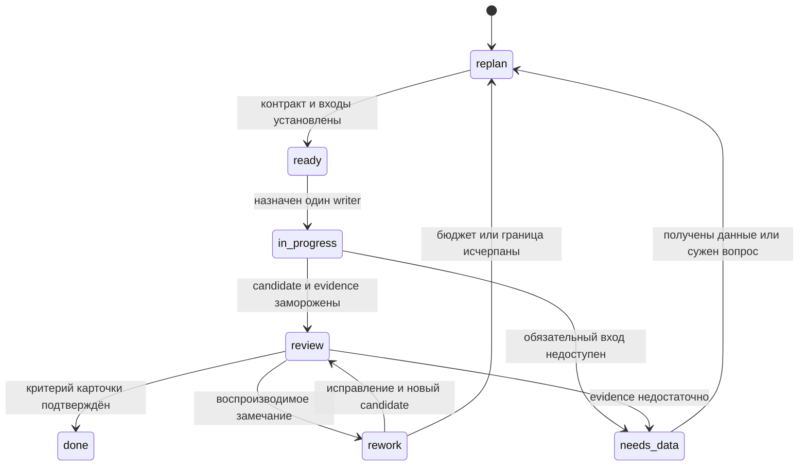

# Автономный рабочий цикл review → refactor

Историческая основа: проект декомпозиции session task от 2026-10-14. В том
REVIEW были разрешены составление общего review, чтение источников и подготовка
документации; реализация, новые scientific runs, полные tests/CI, установка среды
и серверные действия этим текстом не поручались.

Уточнение authority/epoch от 2026-10-19: этот исторический scope не отменяет
последующее прямое поручение пользователя об EXEC
[активного handoff](../implementation/review-closure-2026-10-19/README.md) и
[B/G1/S1 без e–e](../implementation/review-closure-2026-10-19/operator-permissions.md).
Повторно используемый контракт ниже действует в последнем применимом scope;
датированные карточки и их budgets остаются историей, а не новым grant.

[Полный автономный план](autonomous-review-plan.md) раскрывает все RV и SI,
порядок назначения пакетов и checkpoint. Четыре карточки ниже сохраняются как
начальные срезы; лимиты полного прохода назначаются по выбранному плану,
а не складываются с прежним предложением бюджета этих четырёх карточек.

Цель — получить достаточно подробные задания, чтобы агенты самостоятельно
переходили от вопроса к проверяемому решению в уже разрешённом scope. Четыре
результата равноправны: формализация текущих требований, документация, code review
с обоснованными изменениями и научная приёмка с честными границами доказательства.
Исследователь, оператор и разработчик также равноправны. Приоритет конкретного
задания определяется риском и готовностью зависимостей; числовая квота работ
не выражает это равенство.

## Единица работы и источники

Единица работы связывает четыре потока вокруг одного вопроса или поведения:
актуальная цель и предпосылки → проверка кода, интерфейсов, документации и
свидетельств → обоснованный design с владельцем → ограниченное изменение
в уже разрешённом либо отдельно порученном этапе → независимое review и исправление → owner PR →
опубликованный gitlink и повторная release-проверка, когда они поручены.
Документационная задача может закончиться уточнением смысла API; научная —
выводом «данных недостаточно». Оба выхода полезны без изменения solver.

Все четыре потока начинают работу параллельно, когда готовы их собственные
входы. Научная приёмка не становится единственным gate любого документационного
или инженерного изменения. Общая документация не является обязательным
предшественником чтения готового результата или отдельно порученного solve.
Зависимости задаются конкретным требуемым выходом: например, проверка source
identity предшествует переносу старого test receipt, а архивная identity —
интерпретации сохранённого набора.

Текущий запрос пользователя определяет цель и полномочия. Исторические статусы
«С/Н/П», старые чаты, roadmap и [программа review](comprehensive-review.md)
дают перечень утверждений для перепроверки. Они сами по себе не доказывают
нынешние пожелания пользователя. Физические source files описывают реализованные
предпосылки, а не предписывают пользователю следующую постановку.

На каждый пакет фиксируются root ref, gitlinks, dirty overlay и первичные
артефакты. Для исторического audit-пакета 2026-10-14 root —
`e48e5b2ef16d3e6f1d633dd29c95f94d60ca8cc1`; изменения root docs отдельно от HEAD.
Состав выводится из Git, без второго вручную поддерживаемого revision lock:

```console
git rev-parse HEAD
git status --short
git submodule status --recursive
git ls-tree e48e5b2ef16d3e6f1d633dd29c95f94d60ca8cc1 components/
```

Reader получает commit + path/symbol, artifact SHA256 + dataset/selection либо
hash frozen текста. Архивный source, publication branch, установленный runtime
и candidate PR разделяются. Совпадение версии пакета не заменяет source binding.
Изменение входа создаёт новую ревизию карточки и новый review round.
Hash подтверждает identity прочитанных bytes; он не доказывает истинность
содержащегося в них scientific claim или приёмку текущего состава.

## Разбиение до READY

Это канонический повторно используемый контракт задания. Карточка, issue, PR
или checkpoint с этими полями достаточны; handoff и skills ссылаются на него,
а не вводят вторую обязательную форму или регистрацию. Датированный статус
этого review и четыре исторические карточки ниже не задают mode нового
поручения: цель, этап и active grants определяет последнее применимое указание
пользователя, а source и evidence привязываются к выбранному заданию.

Draft может содержать пробелы. До READY координатор разбивает его, пока каждая
атомарная карточка однозначно содержит следующие девять полей.

| Поле | Что должно быть однозначно |
| --- | --- |
| Вопрос, роль и owner | Task/requirement IDs, одно проверяемое поведение или утверждение; польза для трёх ролей либо обоснованная неприменимость; owning repository, один writer и отдельный reviewer по canonical role policy |
| Входы | Неизменяемые source/data refs, paths и hashes; исходные артефакты и доступность обязательных входов; publication branch/PR, runtime и candidate различаются |
| Граница | Уже разрешённые stage/actions/grants и permitted paths, исключённые соседние изменения; один writer на файл/ветку; READY или invocation не расширяет полномочия |
| Invariants | Сохраняемые model, units, grids/basis, tolerances, statuses, identity и durability по применимости |
| Oracle и acceptance | Заранее объявленные property catalogue и denominator; уровень вывода source/metadata/runtime/science; независимый oracle, healthy positive control и применимые negative/near-zero cases; применимость, units, нормировка, веса, допуск и его основание из owning contract |
| Проверка | Точные команды с окружением либо явный static reading protocol; стоимость каждой проверки, граница mocks и наблюдаемого свойства; docs-only не требует численной среды |
| Зависимости | Конкретные outputs предшественников и необходимые checkpoints; missing input блокирует только зависимые действия/выводы, независимые READY задачи продолжаются |
| Бюджет и остановка | Назначенный конечный предел attempts/author-review cycles и общий CPU/RAM/storage/I/O/wall/output envelope всех исполнителей; stop при исчерпании, identity mismatch, unknown outcome или выходе за scope |
| Выход | Finding/design/patch/report и путь; candidate hash/diff, original evidence/failed receipts и фактические checks; disposition каждого declared item, ограничения, решение и residual; resume state, active IDs и оставшийся envelope |

READY означает отсутствие блокирующего неизвестного в контракте задания,
а не заранее известный ответ. Карточка «установить, какие raw данные отсутствуют»
готова, если доступен ограниченный inventory. Карточка «доказать FDR на final
матрицах» требует самих матриц и соответствующих identity до READY.

Unknown, missing и неприменимость получают явную disposition и не исчезают
из denominator молча. Отрицательный результат или установленная недостаточность
данных могут завершить карточку, чей вопрос именно об этом; они не означают
pass недоказанного свойства. Source/static, metadata, runtime и scientific
evidence не подменяют друг друга; process exit, сходимость, physical checks,
достаточность дискретизации и experimental validation принимаются раздельно.

Если locator устарел, агент ищет актуальный symbol в frozen source, проверяет
native metadata и добавляет отдельную подзадачу разведки. Он может самостоятельно
разбить слишком большой вопрос по owners или независимым свойствам, сохранив
цель и scope. Недоступные публичные факты сначала проверяются доступным read-only
способом. Missing private inventory/credentials остаются явным blocker.

## Состояния и независимые раунды

Состояние записывается в карточке, issue или PR; это проектная договорённость,
не новая машина исполнения и не статусы инструментов управления goal.



Координатор выдаёт готовые независимые задания через имеющиеся collaboration
tools. Файл карточки, GitHub issue/PR и сохранённый отчёт достаточны для передачи
контекста. Новый scheduler, machine state registry и orchestration service
для этого review не нужны. Публикация issue, review comment или PR выполняется
только в scope, включающем такую запись; локальный finding не требует её.

Перед каждым review round замораживаются candidate commit/diff hash, input
refs/hashes, original evidence/failed logs, полученные receipts и реально
выполненные checks. Автор и reviewer используют один набор bytes; изменение
входа создаёт новую ревизию карточки и локально инвалидирует зависимые checks.
Первый независимый reviewer получает вопрос, предпосылки, acceptance contract
и оригиналы без готового диагноза автора или его ожидаемого verdict. Он
воспроизводит locator, проверяет negative case вместе с healthy positive
control и достаточность независимого oracle. Затем координатор сопоставляет
замечания с авторским объяснением; согласие не является новым evidence.

Implementer исправляет только owned paths. Новая проверка допустима внутри
порученного бюджета, когда изменился проверяемый материал, появилась ошибка
или осталось открытое свойство. Повтор прежнего успешного suite без причины
не добавляет свидетельства. При assignment фиксируется собственный конечный
предел author/review cycles и общий бюджет; прежнее предложение двух
корректирующих раундов после первого review не является grant. Конкретные пределы
берутся из последнего применимого указания пользователя; датированный
[P1](../implementation/review-closure-2026-10-19/operator-permissions.md)
не вводит дополнительного фиксированного лимита поверх более позднего grant.
Более позднее разрешение использовать доступные ресурсы не отменяет конечный
envelope каждого пакета и не изменяет неотменённые scientific caps, protected
reserves или CI-once. Author/review cycles не увеличивают отдельные
test/attempt counters. Исчерпание ведёт к replan с original failed logs и точным
остатком, а не к циклу «до зелёного» или принятию load-bearing дефекта. Unknown
или отрицательный итог может закрыть порученный read-only вопрос без correction,
когда его acceptance выполнена.

Разногласие разбивается на проверяемые утверждения. Для каждого выбирается
самый дешёвый независимый source check, аналитический oracle или доступный
artifact slice. Голосование и согласие агентов доказательством не являются.
Если проверка требует отсутствующего опыта, вывод остаётся неизвестным.
Reviewer acceptance данной карточки отдельно от physics unknown и full release
acceptance. При отсутствии независимого агента указывается меньшая независимость.
Специальный bootstrap контракт сохраняется: CI один раз на final ready source
ref, без автоматических reruns; общий цикл review не отменяет это ограничение.

## Полномочия, стоимость и маршрутизация

Уже выданный scope grant сохраняется после commit, review, compaction и
resume до изменения или отзыва пользователем. Внутри него агенты выполняют
доступные действия и обратимые внутренние design/implementation choices без
повторного вопроса «продолжать ли?». Последнее применимое указание пользователя
имеет приоритет над historical PLAN prose и прежним proposal; текст workflow,
invocation или READY сами grant не создают. Недостающий факт агент ищет в
active read scope. Missing data/inventory/admission/credentials блокируют
только зависимые действия и claims; другие READY задачи продолжаются.

Для активированных [B/G1/S1 из P1](../implementation/review-closure-2026-10-19/operator-permissions.md)
human policy approval CP-OPS/CP-SCI уже задано: coordinator и независимый
reviewer закрывают technical BIND/READY на конкретных source/targets/resources
и criteria без нового human approval каждой точки или hash. CP-EXCEPTION
остаётся человеку для выхода за approved predicates: новой scientific/model
цели, невыводимого существенного требования, нового trust/credential scope,
destructive target вне разрешённого множества, protected old/foreign jobs,
public release или превышения конечного envelope. Молчание не является согласием.

Grants не заменяют fresh admission и required preflight: four-role NixOS и
strict nginx checks до тяжёлого bootstrap, backup/restore bindings, сохранение
original logs и separate engineering/OPS/science gates задаются
[AGENTS](../../AGENTS.md) и [deployment runbook](../single-server-deployment.md).
Старый S01 и foreign resources защищены; fixed light theme сохраняется.
Общий review loop не разрешает второй final full CI.

Resume начинается с последнего указания пользователя, mode/grants,
source/dirty state, active operation/run/attempt IDs, receipts и оставшегося
envelope; затем проверяется READY зависимых задач. Tool timeout, потеря SSH
или закрытие клиента не доказывают остановку remote action. Перед повтором
обязательна reconciliation по persisted IDs: unknown submit/stop не порождает
duplicate action. Завершённая задача не назначается снова без нового diff,
failure или unresolved свойства. Необходимое расширение оформляется одним
конкретным CP-EXCEPTION, пока независимая разрешённая работа продолжается.

Для будущего дорогого check envelope обязательно содержит: stage и точную
команду; source/model/plan identity; число попыток и раундов; суммарные CPU/core·s,
RAM/peak headroom, wall time; I/O и output limits; stop condition; ожидаемое
различающее свидетельство; ответственного; судьбу original logs и partial results.
Предел общий для всех агентов. Числа берутся из явного поручения и измеренного
доступного host admission, а не придумываются в карточке. Без envelope check
остаётся предложением. Engineering build, deploy/restore и scientific acceptance
имеют отдельные предметы проверки; новый root ref не наследует старую приёмку.

Маршрут зависит от вопроса: [research-framing](../../.agents/skills/qcl-research-framing/SKILL.md)
уточняет постановку; [physics-audit](../../.agents/skills/qcl-physics-audit/SKILL.md)
проверяет уравнения и критерии; [results-analysis](../../.agents/skills/qcl-results-analysis/SKILL.md)
читает existing artifacts; [performance-audit](../../.agents/skills/qcl-performance-audit/SKILL.md)
оценивает стоимость при сохраняемом контракте. Это инструкции, не полномочия.
Engineering ownership/API/PR review получает coordinator brief и native
инструкции; его не следует искусственно включать в physics skill.

Отдельное [review навыков и инструкций](skills-and-instructions-review.md)
проверяет эту маршрутизацию на standalone, already-authorized, missing-data
и engineering случаях. Его acceptance связан с возможностью выполнить READY
карточку без ложной остановки или расширения scope; изменение навыков не входит
в четыре карточки ниже.

Из [метрик](review-metrics.md) выбираются свойства задания: M01 — property
coverage, M06 — source/dependency closure, M12 — coupling/ownership, M14 — API
docs semantics; для scientific карточки — M18/M19 provenance и определённость
критериев. Каталог из двадцати метрик не становится двадцатью обязательными gates.

## Четыре исторические READY-карточки для чтения

Это срез задания 2026-10-14, а не очередь активного EXEC. Общие входы того
пакета — выбранные gitlinks исторического root выше и frozen текст
публичного [root docs ref `9fe2849`](https://github.com/Afonenko-QCL-NEGF/qcl-negf/tree/9fe2849f22e60d928cfced5ed00b595b0f2a2ee9).
`/tmp/qcl-review-replan-20261014/baseline/` и `snapshot.json` — вспомогательная
локальная копия и receipt hashes, не operational source lock и не обязательный
private input. Root docs и root code имеют разные refs. Перед исполнением агент
читает exact public file или совпадающую по hash копию, проверяет чистоту
выбранного component. При изменении identity — replan, без подмены на «latest».

Для того пакета была предложена остановка после 12 минут общего wall time
координатора, не более 96 KiB показанных extracts и 4 KiB отчёта на карточку.
Чтение metadata ограничивается файлами до 64 KiB; большие источники читаются
по перечисленным sections. Этот предел относится к дешёвому аудиту, не к
сборке или solve. Сами исторические карточки не разрешают test execution, fetch/install
окружения, правки implementation или внешнюю публикацию. Общий output — четыре
отдельных отчёта, без overlapping writer paths; при лимите вернуть partial
evidence и самый дешёвый следующий шаг.

### F01 — формализация текущих требований

**Owner:** Root/Research; исполнитель — агент требований. **Роли:** исследователь
понимает предмет приёмки, оператор — границы полномочий, разработчик — owner.
**Вопрос:** имеют ли
три ограниченных утверждения S07, C01 и «S01 — первый обязательный рубеж»
актуальное основание и однозначный предмет приёмки? **Входы:** текущий запрос
пользователя, переданный в coordinator brief; public frozen
[`docs/system/requirements.md`](https://github.com/Afonenko-QCL-NEGF/qcl-negf/blob/9fe2849f22e60d928cfced5ed00b595b0f2a2ee9/docs/system/requirements.md), SHA256
`aaf01fe9b803a0aa34ba5ae9e71559606482e2ad96c3314388dc6c6667096e0d`;
public frozen [`docs/architecture.md`](https://github.com/Afonenko-QCL-NEGF/qcl-negf/blob/9fe2849f22e60d928cfced5ed00b595b0f2a2ee9/docs/architecture.md), SHA256
`8e49c02d948891f31f6d27360564b4a2708d7a1546808d9f10f38d0c5ebec6b7`;
Core gitlink `3108150dd1b6b1377470b384b15c26e272fe5c5d`,
[`src/QCLNEGF.jl`](https://github.com/Afonenko-QCL-NEGF/QCLNEGF.jl/blob/3108150dd1b6b1377470b384b15c26e272fe5c5d/src/QCLNEGF.jl).

**Протокол:** прочитать определения статусов и указанные строки; для каждого
утверждения разделить explicit current decision, historical assertion и
implementation observation. Проверить exports/import boundary для C01,
сопоставить S07 с текущими инструкциями. Не восстанавливать wishes по коду.
**Oracle/acceptance:** таблица requirement → источник решения → owner →
проверяемый output → неизвестное; negative case — историческая «С» без текущего
подтверждения остаётся historical, не automatically mandatory. Сохраняются
четыре равные цели и три роли. **Зависимости:** нет; implementation completeness
не является входом. **Выход/разрешённый write path:**
`/tmp/qcl-review-first-wave-20261014/F01-current-claims.md`,
предложенные уточнения без правки requirements. Если выбор не выводится
из session, сформулировать один предмет решения, продолжая остальные строки.

### D01 — scope документации export bytes

**Owner:** Contracts docs; исполнитель — отдельный агент документации.
**Роли:** исследователь и оператор различают архивные форматы, разработчик
находит соответствующую validator boundary.
**Вопрос:** однозначно ли README различает legacy multipart и новый single
archive? **Входы:** public [Contracts gitlink
`923e0c6cd9cbbe63bd1fb9c77892ef171385ed76`](https://github.com/Afonenko-QCL-NEGF/qcl-negf-contracts/tree/923e0c6cd9cbbe63bd1fb9c77892ef171385ed76);
`README.md:44/67`,
`src/qcl_negf_contracts/artifacts.py::validate_export_receipt`,
`src/qcl_negf_contracts/schemas/export-receipt.schema.json`,
`src/qcl_negf_contracts/schemas/results-contract-set.json`.

**Протокол:** прочитать оба README абзаца, size validation и registry scope;
проследить `EXPORT_PART_MAX_BYTES` к legacy consumer. **Oracle/acceptance:**
сопоставление document claim → validator/schema/legacy reader; предложенный
минимальный patch снимает двусмысленность без смены wire contract. Negative
case — новый receipt >200000000 bytes нельзя объявить invalid из legacy
константы; Boolean/negative bytes остаются отдельной existing validation.
**Invariants:** schemas, API, числа, legacy readability и transport/science
различие сохраняются. **Зависимости:** нет; scientific result не требуется.
**Выход/разрешённый write path:**
`/tmp/qcl-review-first-wave-20261014/D01-export-scope.md` с patch proposal,
M14 семантикой `validate_export_receipt` и M16 drift двух README утверждений.
Разрешено только чтение и отчёт, не изменение Contracts;
publication branch будущего owner PR определится при поручении patch.

### C01 — независимое review существующего Results PR6

**Owner:** Results; исполнитель — reviewer, не автор correction. **Вопрос:**
сохраняет ли переносимая source-ownership проверка независимое происхождение
fixtures? **Роли:** разработчик переносит suite, оператор различает setup
failure и runtime acceptance, исследователь сохраняет независимость oracle.
**Входы:** [существующий draft PR6](https://github.com/Afonenko-QCL-NEGF/qcl-negf-results/pull/6),
base `fe27a2a9ed065f9afacecc84113311f30d0c68d6`, candidate
`a1492b7b86b788885eff683ac71ca1167cbbaff1`, publication branch
`codex/portable-equilibrium-test-ownership`. Exact diff: `README.md`,
`tests/source_ownership.py`, `tests/test_equilibrium_diagnostics.py`,
`tests/test_source_ownership.py`; base hard paths — строки 37–38/112–113.

**Протокол:** read-only получить refs и четыре-file diff; убедиться в совпадении
candidate, отдельно сопоставить numerical assertions/oracles base и candidate.
Пройти sibling, explicit editable и wheel paths, negative shadow/copied source
и conflicting override. **Acceptance:** каждый путь имеет воспроизводимый
finding или обоснованный keep; неизменность scientific tolerances подтверждена
diff, test results из PR body остаются заявленным receipt до проверки source
binding. M06 не сводится к версии `0.2.0`. **Зависимости:** нет; D01 не gate.
**Выход/разрешённый write path:**
`/tmp/qcl-review-first-wave-20261014/C01-pr6-review.md`,
локальные замечания и предложенный targeted check
для будущего бюджета. Не писать GitHub comment, не менять code, не создавать
duplicate PR и не rerun full integration. Несовпадение head → replan.

### S01 — применимость `r_J` и FDR без новых расчётов

**Owner:** Core/Research для criteria, Results для evidence; исполнитель —
physics reviewer. **Вопрос:** что current definitions и доступная metadata
позволяют утверждать о равновесном пределе? **Роли:** исследователь получает
границы вывода, оператор — честный статус, разработчик — criterion/source gap.
**Входы:** public [Core gitlink `3108150dd1b6b1377470b384b15c26e272fe5c5d`](https://github.com/Afonenko-QCL-NEGF/QCLNEGF.jl/tree/3108150dd1b6b1377470b384b15c26e272fe5c5d),
`src/numerics/reference/acceptance_metadata.jl` (`:r_J`),
`src/numerics/reference/validation.jl::validate_solution`,
`src/numerics/reference/solver.jl::_outer_current_residual`,
`src/numerics/optimized/physics_markers.jl::_marker_equilibrium_status`;
public [Results gitlink `fe27a2a9ed065f9afacecc84113311f30d0c68d6`](https://github.com/Afonenko-QCL-NEGF/qcl-negf-results/tree/fe27a2a9ed065f9afacecc84113311f30d0c68d6),
`src/qcl_negf_results/equilibrium.py::diagnose_stored_equilibrium`;
public [Research gitlink `5458212063a41051328ef8b5d14d63d5ac7dc781`](https://github.com/Afonenko-QCL-NEGF/qcl-negf-research/tree/5458212063a41051328ef8b5d14d63d5ac7dc781),
`docs/equilibrium-s01.md`.

**Протокол:** вывести criterion cards: предпосылки, формула, веса, units,
normalization, near-zero branch, tolerance и основание либо точный gap.
Сопоставить `r_J` как plus/minus continuity с абсолютным zero-current вопросом;
FDR marker и finite-μ fit не объявлять acceptance. Metadata читать из
[frozen source audit](https://github.com/Afonenko-QCL-NEGF/qcl-negf/blob/9fe2849f22e60d928cfced5ed00b595b0f2a2ee9/docs/implementation/comprehensive-review-source-audit-2026-10-14.md),
SHA256 `f8b03eca1ef44ae14aee2d3fdd4635b952b1ab96965dcbbb52b4cbcc901d1bf3`:
run `dfb75b38-6019-4861-b868-f51648c71f02`, plan hash
`4d69332f0770734102c77089ad6cbe4cb2a35b1dde71380cfb59fa13680929f9`,
reported saved RUNNING snapshot. Полные hashes находятся в указанном receipt;
exact local copy — `/tmp/qcl-review-replan-20261014/published-source-audit-base.md`.
Оригиналы receipt/raw arrays не приложены: reported metadata отделить от
независимой проверки. **Negative case:** near-zero flux, finite bias,
unequal baths и unavailable arrays не становятся pass. **Зависимости:**
для аудита определений нет; архивная revision/final U/G обязательны перед
будущим numeric verdict. **Выход/разрешённый write path:**
`/tmp/qcl-review-first-wave-20261014/S01-criteria-and-gaps.md`, две criterion
cards и раздельный вектор execution/convergence/physics/discretization/experiment.
Не читать полные массивы, не solve, не менять tolerances; missing evidence —
результат текущего аудита, а не повод запустить опыт.

## Завершение пакета

Координатор показывает человеку только новые deltas: что подтверждено,
какое уточнение/изменение предлагается, какой факт отсутствует и что реально
требует решения. Полные локаторы и original evidence остаются в отчётах.
Future owner PR сначала публикует изменение владельца; root обновляет лишь
опубликованный gitlink после отдельного поручения. Release/science статусы
пересматриваются в области затронутого нового состава.

| Утверждение | Свидетельство | Ограничение | Решение |
| --- | --- | --- | --- |
| Четыре направления допускают параллельный аудит | READY-карточки с отдельными входами и owners | Карточки не равны выполненным audits | Сохранить |
| Автономность требует атомарного контракта и конечных раундов | Поля READY, frozen round, independent review | Предел будущей реализации ещё принимается в её scope | Изменить |
| Existing source/metadata не принимают S01 | Раздельные criterion/evidence outputs S01 | Final archive и raw evidence отсутствуют в этом пакете | Данных недостаточно |
| Новая costly проверка должна различать конкретный спор | Envelope и cheapest independent check | CPU/RAM/attempts не предоставлены этим документом | Дополнительно измерить |
