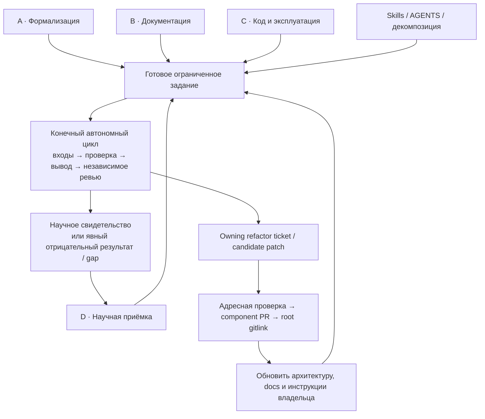

# Программа комплексного ревью QCL-NEGF

Статус: **проект программы после уточнения целей, 2026-10-14**. Четыре цели
имеют равный приоритет: формализация системы, документация, ревью кода и
научная приёмка. Сквозная цель — разложить работу до заданий, в которых агент
может выполнить конечный проверяемый цикл без постоянного обращения к человеку.
Ревью должно привести к обоснованному рефакторингу и дальнейшему улучшению,
а не только к каталогу дефектов. Эта редакция готовит программу; она не
поручает менять продуктовый код, сервер, solver, skills или `AGENTS.md`.

Подтверждённая текущая научная цель — первый физически осмысленный результат
с сопоставлением опубликованному исследованию. Конкретные вопрос, структура,
наблюдаемая и первый рубеж требуют актуального контракта. Прежний S01
при 0 mV/period и 70 K сохраняется как исторически выбранная постановка и
наблюдавшийся запуск; он не становится автоматически главным требованием
новой программы. Если новый вопрос требует именно этого равновесного предела,
его условия и критерии подтверждаются адресно.

## Что считать исходной опорой

Прежние документы готовились для затянувшейся сессии и могут расходиться
с нынешними требованиями и планами. [Requirements](requirements.md),
[архитектура](architecture.md), [roadmap](release-roadmap.md) и
[entrypoint](implementation-entrypoint.md) — материалы для актуализации.
Метка «С» хранит последнее известное согласование, но сама не доказывает
повторного подтверждения сегодня. Указание старой entrypoint «Требования со
статусами С/Н сохраняются» читается как сохранение истории этих статусов,
а не запрет перепроверить применимость. Это не отменяет автоматически все
прежние решения: сохраняются формулировки, источники, даты и последнее состояние.
Текущие указания пользователя, светлая тема интерфейса, равноправие ролей
и научная добросовестность действуют; остальные спорные решения проходят RV00.

RV00 составляет компактный ledger: утверждение/ID, первичный источник и дата,
последний известный статус, текущее свидетельство, противоречие или пробел,
решение «подтвердить / уточнить / заменить / вывести из текущего scope».
Решение о требовании отличается от наблюдения кода: существующий механизм
не становится требованием только потому, что уже реализован. Изменять
принятый контракт можно после нужного решения, а историческую запись следует
сохранить. Проверка одного спорного решения не задерживает независимые задания.

Исходный срез кода — root `e48e5b2ef16d3e6f1d633dd29c95f94d60ca8cc1`
и его восемь gitlinks. Git остаётся источником состава; новый ручной lock
ревизий не создаётся. Dirty overlay, опубликованный PR, installed release,
frozen plan и архивная ревизия учитываются отдельно. История источников и
проверенных локаторов сохранена в
[аудите от 2026-10-14](../implementation/comprehensive-review-source-audit-2026-10-14.md).
Он фиксирует минимальный runtime с одним compute и начатый S01, но не
устанавливает live-статус сейчас, terminal result или научную приёмку.

## Четыре параллельных направления

У каждой линии есть собственный первый выход, следующая проверка и очередь
готовых заданий. Равный приоритет означает одинаковую значимость результатов,
а не механическое деление бюджета на четверти. При выборе следующего задания
учитываются готовность входов, риск ошибки, различающее свидетельство,
стоимость и влияние на другие задачи. Неизвестный runtime или научный verdict
не закрывает статическое ревью документации, исходников и инструкций.

| Линия | Первый вопрос и выход | Что позволяет двигаться дальше |
| --- | --- | --- |
| **A. Формализация** | Какие цели и ограничения действуют сейчас? Ledger RV00; actual baseline по коду, владельцы и альтернативы RV03; brief исследовательского вопроса RV10 | Выбранному ticket достаточно проверенного локального контракта и owner; полная будущая архитектура ещё может обсуждаться |
| **B. Документация** | Какие материалы есть, кому и насколько помогают? Инвентаризация RV16, близкие к коду API/schema/config facts RV19, варианты общего входа RV18 | Можно проверять одну главу, reference и runbook независимо; выбор генератора следует из пробного среза |
| **C. Код и эксплуатация** | Какие свойства реально обеспечивают owning components? Карты coupling, состояния, tests/oracles, отказов, release и инфраструктуры RV02/04–07/09/11–15 | Статическое исследование начинается по выбранному source; runtime checks требуют только собственных prerequisites и бюджета |
| **D. Научная приёмка** | Что доказывает текущий результат и какой следующий результат нужен? Identity и пробелы RV01; модель/критерии/oracles RV08–10; operator evidence | Готовые physics/results audits идут сейчас; новый SCBA/Poisson или refinement начинается после контракта, admission и конечного бюджета |

Аудит навыков и инструкций RV17 проходит через все четыре линии как отдельное
направление работы. Его входы и выходы описаны в
[программе skills/AGENTS](skills-and-instructions-review.md), а устройство
конечного агентного цикла — в [рабочем процессе](agent-review-workflow.md).
Это проекты правил и приёмки поведения, а не уже действующая автоматизация.

Схема показывает организацию ревью. Она не добавляет runtime, сервис,
scheduler или право выполнять новый опыт. Научное свидетельство сохраняется
отдельно от инженерной приёмки candidate patch.

## Роли и границы объяснения

Исследователь формулирует вопрос, понимает модель, поручает опыт и читает
результат. Оператор устанавливает, наблюдает, отменяет, обновляет и
восстанавливает систему с сохранением данных и чужих ресурсов. Разработчик
понимает границы, меняет owning component и проверяет последствия. Все три
роли равноправны в каждой линии. Для каждого выхода указать, какое действие
сможет выполнить каждая роль, какой факт найти и какое ограничение увидеть.
Научная ясность не заменяет recovery contract; успешный deploy не подтверждает
уравнения. Общая документация связывает роли с владельцами, сохраняя формулы
в Core/Research, persistence в Runner и представление в Portal.

Actual architecture восстанавливается из imports, вызовов, CLI/HTTP,
schemas, файловых форматов, ресурсов и mutable state. Repository boundary
не равна runtime process boundary. Context/container, job/data/release
lifecycle и deployment/storage views различают факт и предложение; у каждого
edge есть source, owner и направление. Декларируемый DAG не исключает
dynamic import, файловую или orchestration cycle.

Связность оценивается по совместно изменяющимся обязанностям и последствиям
изменения контракта. Сложность — по состояниям и переходам, exception paths,
скрытым эффектам, зависимости от порядка и объёму рассуждения для локальной
правки. LOC выбирает hotspot, но не доказывает дефект. Для refactor назвать
сохраняемый invariant, границу мутации и различающий check. Общий код
reference/optimized может разделять одну ошибку; независимый oracle нужен
там, где утверждается правильность численного метода.

## Источники, тесты и научное свидетельство

Для существенного вывода нужен воспроизводимый локатор: commit + path/symbol,
статья + формула либо artifact hash + HDF5 path + выборка. Согласие агентов
не является доказательством. Первому независимому рецензенту дать вопрос,
предпосылки и первичные источники без готового диагноза; затем сопоставить
возражения и сохранить самый дешёвый способ разрешить разногласие.

Карта тестов связывает property → producer/consumer → fixture → assertion
→ предел mock. Процент line coverage не устанавливает качество oracle.
Проверяются mutation, exact attempt selection, отсутствие двойного submit,
partial writes, timeout/retry/cancel, worker/NFS loss и recovery eligibility.
Mock transport не доказывает Slurm/NFS; synthetic fixture не подтверждает
физику прибора. Методика и ограничения метрик находятся в
[review-metrics](review-metrics.md); двадцать показателей не становятся
обязательными gates каждого PR.

Адресные вопросы из source audit сохраняются: composite export должен связать
plan и bytes с одним exact attempt; это иная граница, чем single-file download.
Его Portal/AiiDA локаторы относятся к отдельному опубликованному source,
поэтому регрессия текущего checkout не объявляется установленной. Для
cross-language schemas нужны valid/invalid случаи bool/int/nonfinite/origin,
а для Portal `hatch_build.py` — связь assets с source и lock. Сначала проверить
эти границы статически, затем сформировать минимальные различающие fixtures.

| Уровень утверждения | Необходимое различающее свидетельство | Что оно само не доказывает |
| --- | --- | --- |
| Процесс / приложение | Identity, state/error contract, unit/contract и выбранные integration/failure/recovery paths | Сходимость уравнений или реальные production recovery гарантии от mock |
| Решение уравнений | Raw map/Poisson residual, согласованные U/G, norm/weights/units и независимый операторный oracle | Достаточность окна, сетки или базиса |
| Физические проверки | Выведенное тождество, применимость, нормировка, допуск и основание, near-zero правило, исходные diagnostics | Проверку отсутствующего рассеяния или универсальную симметрию по bias |
| Дискретизация | Сопоставимые controlled refinements, axes/cutoffs/basis identity и чувствительность наблюдаемой | Экспериментальную валидацию |
| Эксперимент | Опубликованные условия/uncertainty, model scope, units, независимое сравнение и provenance данных | Правильность любых других режимов и моделей |

Полная цепочка: вопрос → предпосылки/уравнения → дискретизация → symbol →
наблюдаемая → критерий → свидетельство. Применимость и missing data явны.
Нельзя требовать положительный gain, монотонную I–V или постоянный
энергоразрешённый ток без вывода для постановки. Влияние конечного basis на
локальный ток проверяется отдельно. Не менять scattering, сетку, окно,
допуски или модель ради ускорения и зелёного статуса. Отрицательный результат,
непринятая сходимость и недостаточная дискретизация — полноценные выходы.

## Очередь вопросов с устойчивыми ID

RV01–RV19 сохранены для связности прежнего обсуждения; добавлен RV00.
P0 — первый адресный выход линии или prerequisite конкретного задания;
P1 — следующее уточнение. Это локальные ранги, не общий physics critical path.
В графе зависимости указывается необходимый **результат**, а не требование
завершить всё ревью с этим ID. Ни одна строка не разрешает автоматически
запускать checks или менять код.

### A · Требования и формализация

| ID / ранг | Owner и вопрос | Проверяемый выход | Зависимость / доступный первый шаг |
| --- | --- | --- | --- |
| RV00 / A-P0 | Root + три роли: что актуально, а что требует пересмотра? | Ledger старых claims, текущих целей, источников и решений; спорные «С» не перенесены как новые согласования | Текущий запрос + прежний corpus; адресные вопросы только о решении, необходимом зависимому ticket |
| RV03 / A-P0 | Root/all owners: какие границы и интерфейсы есть в коде? | Actual dependency/context/container и job/data/release/deployment views; proposed alternatives отдельно; owner/source каждого edge | Root+gitlinks, imports/calls/configs. RV01 нужен лишь для installed/archive views, а не всей baseline |
| RV10 / A-P1, D-P0 | Research + оператор/разработчик: какой исследовательский контракт отвечает текущей цели? | Brief: вопрос, гипотезы, alternatives, модель, наблюдаемые, публикация для comparison, критерии/бюджет/stop; calibration и validation разделены | Текущая цель, scientific inputs/passports и RV00 для спорных условий; `docs/equilibrium-s01.md` — один кандидат, не готовый новый выбор |

### B · Документация

| ID / ранг | Owner и вопрос | Проверяемый выход | Зависимость / доступный первый шаг |
| --- | --- | --- | --- |
| RV16 / B-P0 | All docs owners: что помогает каждой роли, что устарело или отсутствует? | Docs/API/config inventory: purpose/source/date/status/owner/audience; три равные journeys; одна самостоятельная глава, reference и goal runbook | Чтение текстов и signatures сейчас; RV03/07/08 только для утверждений выбранного среза. [Java PR13 методика](documentation-methodology.md) применяется к изложению |
| RV19 / B-P1 | All code/docs owners: какие факты держать возле реализации? | Source-of-truth matrix: docstrings/types, schemas/options, API/CLI/defaults/errors, canonical examples; generated и авторский смысл различимы | Один выбранный API/config boundary RV07/16; static extraction сначала, import/evaluation prototype — отдельное задание |
| RV18 / B-P1 | Root/docs/Portal/Platform: как дать единый вход, поиск и конфигурационную справку? | ADR вариантов, pilot главы/API/runbook, links/anchors/source binding, offline/local assets, fixed light, public/private exclusions | Инвентаризация выбранных материалов RV16/19, существующий HTML artifact; полный перенос всех docs не prerequisite pilot |

### C · Код, приложения и инфраструктура

| ID / ранг | Owner и вопрос | Проверяемый выход | Зависимость / доступный первый шаг |
| --- | --- | --- | --- |
| RV02 / C-P0 | Results: переносимы ли existing diagnostics tests? | Review [draft PR6](https://github.com/Afonenko-QCL-NEGF/qcl-negf-results/pull/6), source binding и candidate acceptance; без дубликата PR | `fe27a2a`, `tests/test_equilibrium_diagnostics.py:37–38,112–113`: личные absolute paths; сначала diff, выбранный запуск — отдельный бюджет |
| RV07 / C-P0, B-P1 | Contracts/consumers: едина ли semantics schemas/API/status? | Producer/consumer/version/migration matrix, attempt selection, missing states, precision/limits; список несовпадений и targeted fixtures | Contracts `923e0c6`, README:44/67 и export-receipt schema; Runner `0c53c6d`, `schema/PROVENANCE.json`; одинаковые hashes не доказывают drift guard |
| RV04 / C-P1 | Core/Runner: совпадают ли cohesion и владение обязанностями? | Coupling/mutation/cycles/change-impact карта; physics — Core, persistence/resources — Runner; маленькие refactor candidates с invariant | `src/QCLNEGF*.jl`, composition/application/infrastructure; актуальная локальная граница RV03 |
| RV05 / C-P1 | AiiDA/Portal: контролируема ли сложность execution/API? | States/errors/concurrency table, owner profile/handles, deadline/admission review и различающие failure cases | `service.py`, `workflow.py`, `api.py`; `AiidaService._call/close` требует проверки responsiveness, наблюдённый hang не установлен |
| RV06 / C-P1 | Platform: однозначен ли lifecycle owner? | Desired/observed state, durable intent, serial entry, transition/recovery table; отказ не открывает admission | `ops/application_release.py`, `worker_lifecycle.py`, `bootstrap_build.py`; crash между profiles/allowlist/environment/ready marker рассматривается до опыта |
| RV09 / C-P1, D-P1 | Core/Runner/Results/Research: какие properties покрыты независимыми tests? | Producer/consumer/assertion/oracle/gap matrix; analytic и manufactured fixtures с пределами; candidate test tickets | Existing tests и выбранные contracts RV07/08; agreement reference/optimized недостаточен, numerical runs имеют свой бюджет |
| RV11 / C-P1 | Runner/Results: сохраняются ли данные и identity при отказе? | Publication/checkpoint/staging/read invariants; partial write/ENOSPC/NFS/worker loss packet; исходные массивы сохранены | `commit_point_artifacts`, persistence/state/archive code и saved fixtures; durability отдельно от science verdict |
| RV12 / C-P1 | AiiDA/Runner/Platform: ограничены ли выполнение, retry и отмена? | Timeout/idempotency/cancel parent+job/budget matrix; после submit failure нет скрытого дубля | `workflow.py`, staging и Slurm adapters; static paths/fixtures сейчас, production cancellation позднее |
| RV13 / C-P1 | Platform/private site: что делает инфраструктуру восстановимой? | Roles/config/drift/cold-start/reinstall/restore contract, coordinated DB+repository, VM/data/foreign ownership | Public IaC/runbooks + sanitized inventory; отсутствующий admission/inventory — gap, реальный restore — отдельный опыт |
| RV14 / C-P1 | Root/Platform: воспроизводимы ли build, release и imported source? | Native locks/source/artifact/runtime chain, reused-output contract и offline dependencies; новый ref не наследует full acceptance | `ops/`, Nix/application/solver outputs и saved receipts; package version 0.2.0 не заменяет imported commit |
| RV15 / C-P1 | Portal/AiiDA/Platform: обоснованы ли security boundaries? | Auth/read/submit/cancel/download, executable inputs, trusted CI/private configuration/logging review; rejected paths с локатором | Source и synthetic inputs; secrets/private inventory не читать или публиковать ради полноты отчёта |

### D · Научная приёмка и текущий результат

| ID / ранг | Owner и вопрос | Проверяемый выход | Зависимость / доступный первый шаг |
| --- | --- | --- | --- |
| RV01 / D-P0 | Research/Results/operator: что известно о наблюдавшемся S01? | Source/runtime/plan/run/attempt/artifact паспорт, terminal result либо точный gap; execution и science в разных полях | Saved receipts и bounded metadata/выборки; последний прочитанный RUNNING от 2026-10-13 не live now; новый submit для заполнения пробела не нужен |
| RV08 / D-P0 | Core/Research: какие физические утверждения реализованы и чем проверяются? | Formula→assumptions→discretization→symbol→observable→criterion ledger, units/norm/weights/near-zero, basis/model limits и независимые oracles | `theory/`, `physics/`, `traceability.md`, выбранные inputs; статический physics audit не ждёт terminal S01 или готового docs hub |

RV10 выбирает текущий вопрос, RV09 связывает метод с tests. Новые расчёты
не заменяют отсутствующий provenance старого результата. Если comparison
требует ненулевого транспорта, равновесный S01 остаётся проверкой предела,
а условия следующего опыта формулируются отдельно.

## RV17 · Навыки, инструкции и автономная работа

**RV17 / X-P0**, owner Root/skill owners с участием всех трёх ролей:
помогают ли инструкции выполнить готовое задание во всех четырёх линиях?
Проверить actual `AGENTS.md`, component instructions и каждый из четырёх
QCL skills: `qcl-research-framing`, `qcl-physics-audit`,
`qcl-results-analysis`, `qcl-performance-audit`. Для каждого нужен отдельный
выход: applicability/inputs, самостоятельная единица работы, source/evidence
contract, разрешённые действия, cost/stop, failure/unknown поведение,
handoff и предложения правок. В этом этапе skills не редактируются.

Программа [skills-and-instructions-review](skills-and-instructions-review.md)
разворачивает конкретные проверки и candidate changes. Критерий полезности —
tabletop acceptance поведения, а не число новых инструкций. Сценарии включают
устаревшее «С», уже порученный reversible docs/code шаг, existing result с
missing provenance, отрицательную физическую проверку, performance proposal
со скрытой сменой модели и heavy check вне бюджета. Проверяется продолжение
независимых задач при blocker одной линии и отсутствие повторного запроса
на уже разрешённый шаг. Формулы и scientific acceptance не переносятся в skill.

RV17 не ждёт окончания RV00–RV16 и не создаёт ещё одного центра разрешений.
Он уточняет агентный интерфейс их заданий, выявляет противоречия router/skill/
owner instructions и даёт поведенческую приёмку для будущих instruction PR.
Неизвестное требование обозначается как требующее решения, а отсутствующее
измерение — как неизвестное, без изобретения согласования пользователя.

## От вопроса ревью к изменению владельца

В [agent-review-workflow](agent-review-workflow.md) фиксируется конечный цикл.
Готовый ticket имеет вопрос/сохраняемое свойство, owner и разрешённые файлы,
immutable inputs, ожидаемый артефакт, критерий, минимальный различающий check,
budget/stop, exclusions и конкретную границу обращения к человеку. Крупная
строка RV разбивается до такого ticket; это работа ревью, а не задание агенту
самостоятельно придумать полный релиз и выполнять его до успеха.

Prerequisite обязателен только если без него нельзя достоверно проверить
данное свойство или безопасно выполнить выбранный шаг. Примеры: точный attempt
нужен для export comparison; source/owner достаточен для API docs audit;
frozen model/criteria нужны для научного refinement; restore требует fresh
admission и inventory. Agent выполняет доступные обратимые шаги внутри scope
без повторного общего согласования. Вопрос человеку нужен при недостающем
научном выборе, новых полномочиях или обязательном внешнем входе; параллельные
готовые задания продолжаются. Истечение времени не означает согласие.

Каждый finding превращается в решение «сохранить / изменить / дополнительно
измерить / данных недостаточно». Для изменения: проблема и trigger, owner,
invariant поведения/физики/данных, альтернатива, минимальный candidate patch,
проверка и пределы её доказательства. Последовательность будущей реализации:
candidate patch → адресные tests/checks → независимое ревью → owning component
PR → опубликованный root gitlink. Обновить близкие к коду docs/contracts;
научное изменение получает отдельный контракт и приёмку. Root документация
не дублирует новую будущую архитектуру в каждом отчёте.

## Стоимость и публикация

Сейчас разрешено адресное чтение и статические проверки документации.
Docs build с import/precompile/doctests, selected unit/contract/integration,
production build/boot/delivery/restore и science SCBA/Poisson/refinements —
разные классы будущих checks. Для каждого дорогого этапа заранее назначить
attempts, суммарные CPU/RAM, wall time, output limit, stop и ожидаемое
различающее свидетельство; бюджет общий для всех агентов. Не выполнять полный
suite без проверки, вызывает ли он Julia producer или реальный solver.
Повтор нужен лишь после нового изменения, failure или неразрешённого свойства.
Fresh source ref, runtime и admission сохраняются; build/docs/process pass
не объявляется полной release или научной приёмкой.

RV16–RV19 используют [методику документации](documentation-methodology.md):
связная глава по подходу Java PR13, точная reference и goal runbook.
Инвентаризация охватывает короткие configs, effective defaults/override origin,
API/CLI/schema/options, model/source cards и три journeys. Сравнить static hub
MkDocs/Quarto + существующий Documenter, multi-repo подход и минимум интеграции
на одном срезе. Предпочтения генератора — гипотезы до ADR и pilot. Owning Markdown
подключается без independently edited копий; generated signatures не объясняют
физическую семантику. Общий вход, поиск, formula/API links и version/source
binding проверяются отдельно. Fixed light действует также при тёмной теме ОС;
math/fonts/search доступны локально. Private supplements, inventories и raw
operational logs не включаются в public bundle.

## Выход программы

Ревью даёт четыре самостоятельных комплекта: актуализированные цели и baseline;
docs inventory/пилот/owner migration; локализованные code/operator properties
и refactor tickets; scientific contract и раздельные результаты проверок.
Пятый сквозной выход — оценка skills/AGENTS и ready-task workflow. Незавершённая
приёмка одной линии не маскируется общей меткой pass и не блокирует независимый
адресный fix. Завершение конкретного ticket доказывается его артефактом и
критерием, а не числом выполненных строк программы.

| Утверждение | Свидетельство | Ограничение | Решение |
| --- | --- | --- | --- |
| Четыре цели и три роли имеют равный приоритет; нужна автономность конечных заданий | Уточнение пользователя 2026-10-14; четыре линии и RV17 | Эта программа ещё не доказательство исполнения | сохранить |
| Старый corpus может содержать устаревшие требования и план | Уточнение пользователя; прежние «С», S01 и source-specific audit entries | Не все прежние решения отменены; каждый claim требует своего решения | изменить |
| Actual source baseline можно ревьюить уже сейчас | Root `e48e5b2…` + gitlinks; локаторы RV03–RV15 | Checkout, installed runtime и archive identity различаются | сохранить |
| Наблюдались minimal runtime и начатый S01 | Датированный source audit, receipt/plan/run hashes и saved RUNNING | Live/terminal/science verdict и нынешний первый контракт не установлены | дополнительно измерить |
| Навыки и документация требуют самостоятельного review, как и код | RV16–RV19 и два связанных рабочих проекта | Candidate patches, tabletop и publication pilot ещё впереди | изменить |
| Полная научная и release приёмка остаётся открытой | Раздельные gates и пределы существующих свидетельств | Статическое ревью не выполняло builds/tests/solver/server checks | данных недостаточно |
