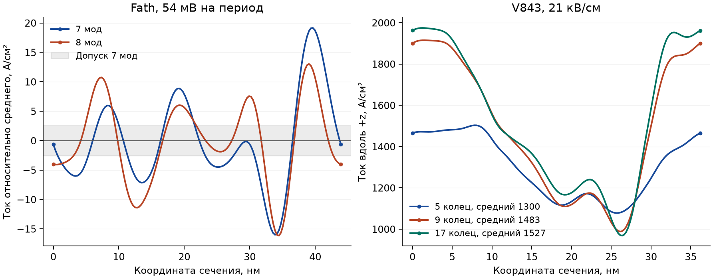

# Пространственный дефект Fath и радиальная мера V843

Продолжение исследования тёмного транспорта на исходных
версиях приложения `497ac103d8b28d642e1062e4529278589f87d8ac`
и Core `c2f45cae21c3e2e4257805ea9c30f9c1d80a7515`.
Хартри в этих опытах фиксирован на нуле.
[Исходное исследование](../fath-v843/) · [План опытов](protocol.md) · [Команды воспроизведения](reproduce.md)

- **Fath, 54 мВ на период и 10 К.** На первой карте расширение
  7→8 мод меняет форму профиля тока на 13,1 А/см², а смена
  исследованной LO-меры на 0,7 А/см². На 48-й карте при
  сопоставимых свежих невязках ранговой сдвиг формы
  составляет 9,70 А/см². Дефект при 8 модах равен
  16,15 А/см² при допуске 2,57 А/см². Возвращение
  подробного равновесия узлового LO-оператора оставляет
  профиль Fath прежним в пределах численной точности.
  [Разбор Fath](fath.md)
- **V843, 21 кВ/см и 50 К.** На входе 48-й карты уточнение
  5→9→17 колец даёт средние токи 1299,60→1482,74→1527,03 А/см².
  На 17 кольцах температура четырёх сопоставленных подзон
  достигает 134,97 К против 159 К у Jonasson, а e/u равно
  1,803 против 0,60. Свежий профиль остаётся пространственно
  неоднородным; температурный и подзонный контрасты
  чувствительны к радиальной мере.
  [Разбор V843](v843.md)

[Отчёты и контрольные суммы](evidence/)

## Решения по ветвям

| Ветвь | Решение |
| --- | --- |
| A. Fath, LO × ранг | Продолжен вариант с расширенным рангом и исходной LO-мерой. Контраст по рангу намного больше контраста по переносу и их взаимодействия. |
| B. Штатный LO | Число частиц, направления переноса и причинные компоненты прошли проверки. Узловое нарушение подробного равновесия воспроизводится и устраняется на эталоне. Повтор руки A дал верхнюю измеренную разность профилей $9,27×10^{-12}$ А/см². |
| C. V843 | На общем входе измерена радиальная чувствительность тока, температуры и e/u. Остающееся расхождение подзонных наблюдаемых и невязки уточнённых карт ограничивают вывод. |
| D. Продолжение | Ранговая чувствительность сохранилась при сопоставимых свежих невязках и подтвердилась на отдельном F25. Второй F13-источник дал близкую форму дефекта и другой средний ток на незавершённых картах. |
| E. Хартри | Условие внутренней согласованности не достигнуто. Три строгие свежие проверки и допуск пространственного тока остаются критериями начала сравнения. |

Установленная поправка подробного равновесия не устранила
дефект Fath. Условия для переноса подтверждённого
исправления пространственного остатка на V843 не выполнены.
[Физические ограничения и результаты](fath.md) · [Радиальная граница вывода](v843.md)
