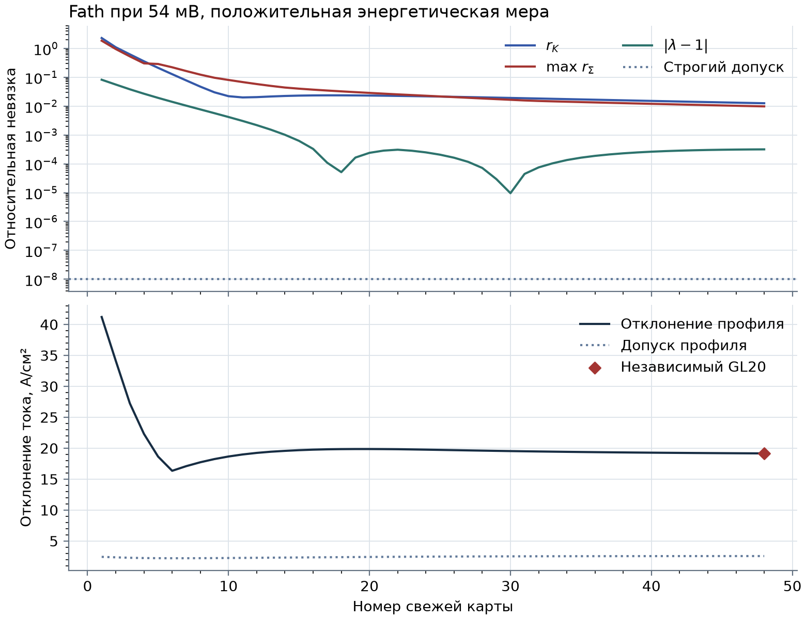

# Fathololoumi при 54 мВ на период и 10 К

Пять каналов на связанном пространстве Q21, семь мод на период, девять
периодов и фиксированный $U_H=0$. Для входа F13(x9) использованы 481
энергетический узел и 13 колец. SHA-256 входных компонентов, веса,
знак тока, источник состояния и версии зафиксированы в отчёте. [Паспорт](fath-device.toml) · [Полный профиль F13](evidence/fath-F13-profile.json)

## Исходный профиль и локальная причина

| Наблюдаемая одного свежего состояния | Значение |
| --- | ---: |
| Средний внутренний $J$, А/см² | 99,7510 |
| Диапазон по 145 сечениям и швам, А/см² | 83,3083–113,6973 |
| Максимальное отклонение от среднего, А/см² | 16,4428 |
| Допуск по профилю, А/см² | 1,0000 |
| Наружный ток слева / справа, А/см² | −113,16223 / +113,16411 |
| Максимальное расхождение GL20/full и GL9/13/18/selected, А/см² | 0,0000585 |
| Изменение узлового $J(z)$ при унитарном повороте, А/см² | 1,95×10⁻¹¹ |
| Сырой листовой заряд, см⁻² | 3,74010×10¹⁰ |
| $\lambda$ до нормировки, $r_K$, max $r_\Sigma$ с полостями | 1,246698 / 0,197914 / 0,555542 |
| Наибольший интегральный спектральный дефект по кольцам | 8,63×10⁻⁶ |
| (langle E_k
angle/k_B) по всей физической ячейке | 44,0862 К |

У минимума при 25,614 нм ток упал от левого шва на 29,8540 А/см².
Накопленные вклады в А/см² составили −28,2520 для шероховатости
интерфейсов, −16,3307 для примесей, +17,7611 для LO, −1,7898 для акустики,
−1,5626 для сплава и +0,3199 для разности BDD и проекции. Отдельные
источники меняются вдоль периода и компенсируют друг друга у швов.
Максимум проекционной разности по всем сечениям равен 3,2193 А/см².
Два независимых способа интегрирования наблюдаемого на данном $G$
согласуются с запасом. Узловая проверка унитарной инвариантности
покрывает смену координат при том же пространстве.

При подстановке тех же свежих источников на предыдущем сыром $G$
максимум накопленного кинетического остатка составляет 251,121 А/см²,
а максимум примесного вклада 275,541 А/см². Для расчёта столкновений
использовалась парно нормированная предыдущая $L/G$; аудит на сыром $G$
показывает полный лаг источника и нормировки. На свежем $G$ тождество
модового Dyson для lesser замкнулось с относительным остатком
7,77×10⁻¹⁶. Свежие нелинейные невязки и сырой заряд превышают допуск
стационарного транспорта.

## Отложенный вход F25

Замороженная проверка 959×25 сохранила тот же связанный Q21,
поле, температуру и фиксированный $H$. Этот вход имеет собственную
историю продолжения, вместе с уточнением энергии и радиуса. Сравнение
с F13 измеряет устойчивость вывода к смене входа и сетки.

| Наблюдаемая свежего состояния F25 | Значение |
| --- | ---: |
| Средний внутренний $J$, А/см² | 181,0189 |
| Диапазон по всем сечениям и швам, А/см² | 143,6027–223,4766 |
| Максимальное отклонение и допуск, А/см² | 42,4577 / 1,8102 |
| Наружный ток слева / справа, А/см² | −194,58278 / +194,58377 |
| Разность полного GL20 и исходного правила, А/см² | 3,79×10⁻⁸ |
| Сырой заряд, см⁻², и $\lambda$ | 3,34741×10¹⁰ / 1,115802 |
| Узловой $r_K$ и независимый $r_{K,Q}$ на положительной мере | 11,91134 / 6,28443 |
| Max $r_\Sigma$ с полостями, max спектральный дефект | 0,90369 / 2,38×10⁻⁶ |
| $\langle E_k\rangle/k_B$ | 75,9126 К |

Минимум сдвинулся к 14,332 нм. На нём ток упал от левого шва
на 50,9801 А/см². Вклады IFR и примесей составили −32,3537
и −31,0905, LO +15,2665, акустики −2,3501, сплава −1,8885,
разности BDD и проекции +1,4363 А/см². Максимум ошибки проекции
по всем сечениям 6,9317 А/см². На старом сыром $G$ со свежими
источниками максимум накопленного кинетического остатка
1094,573 А/см², примесный максимум 1037,264 А/см².
Даже при почти совпадающих швах пространственный критерий превышен
в 23,5 раза. Независимое уточнение наблюдателя сохраняет этот вывод.

В абсолютной энергетической шкале два наружных потока дают
−105,075 кВт/м². Среди поднятых составляющих LO −144,015,
примеси +53,733 и IFR −14,286 кВт/м². Проекционная поправка
+1,331 кВт/м². Переход к локальной потенциальной шкале выделил
+97,801 кВт/м² работы поля и +7,274 кВт/м² взвешенного обмена
частицами, при относительном наружном остатке +0,460 Вт/м².
Эти моменты измерены на несошедшейся карте.
[Все сечения и кинетическая невязка F25](evidence/fath-F25-profile.json)

На полном узловом F25 при тех же прямых $L/G$ замена
эрмитовой части повысила среднее 113,4977→196,5991 А/см²
и уменьшила отклонение 39,5497→30,1584 А/см². Сырой
$\lambda$ вырос с 0,72236 до 1,82403, в обоих плечах
$r_K=11,91134$. Максимум $r_\Sigma$ полостей 0,85492→0,91104,
$T_e=65,541\to99,620$ К. Канонический узловой образ совпал с
парным PV-контролем до 8,83×10⁻¹² А/см². Канонический GL20
даёт 181,0189 А/см², что показывает величину межузлового вклада.
Прямое продолжение изменило относительно парного контроля вклад
25–26 мэВ с 6,6220 до 4,5971 А/см² и вклад 26–27 мэВ с
10,1210 до 16,8862 А/см². Каноническая тройка даёт 4,1115
и 17,0298. Максимальное расхождение двух правил 0,000094 А/см².
Изменение первого окна имеет противоположный знак относительно
F13, причём F25 отличается сеткой и замороженным входом.
[Отложенная парная проверка примесей](evidence/fath-F25-impurity.json)

## Хвосты и энергетические потоки

При одинаковом свежем источнике, числе мод, координатной сетке и
положительной энергетической квадратуре расширение хвостов с двух
до трёх соседних периодов изменило профиль максимум на 0,15484 А/см²,
среднее на −0,00389 А/см², температуру на −0,000071 К.
Независимая координатная сборка (W^dagger H_{
m BDD}W) воспроизвела
исходный $H$ с относительной ошибкой 1,67×10⁻¹⁵. Обе ветви сохраняют
пространственный дефект более 16,4 А/см². Это проверка именно длины
хвостов при данном числе мод и данном замороженном источнике.
[Общая квадратура и оба профиля](evidence/fath-F13-tails.json)

Спектральный поток сшит в абсолютной энергетической шкале $E$.
Его наружные моменты составили −40,566 и −20,542 кВт/м² слева и справа,
их сумма −61,108 кВт/м². Поднятый LO-момент равен −68,328 кВт/м².
Сумма поднятых моментов пяти каналов и проекционной поправки
+0,577 кВт/м² восстанавливает измеренную разность абсолютных потоков.
В шкале $E+e\Delta V z/L$ наружные значения становятся −40,566 и
+40,567 кВт/м². Разность шкал складывается из работы поля
+53,916 кВт/м² и взвешенной пространственной дивергенции тока
+7,193 кВт/м². Последний член следует из дискретного правила произведения
для $\Delta V(z)J(z)$ и сохраняется на этой несошедшейся карте.
При ненулевом интегральном обмене частицами отдельный момент канала
зависит от выбора нуля $E$.

## Парная замена примесной самоэнергии

Обе сравниваемые ветви используют одинаковые прямые $L/G$ и ширину
$\Gamma=i(\Sigma^>-\Sigma^<)$. В контроле эрмитова часть берётся из
преобразования главного значения с прежней константой. В прямой ветви
(Sigma^R_{
m imp}=K_{
m imp}[G^R_{
m old}]). Одна положительная
координатная ковариация и одна радиальная мера действуют на все три
компоненты. Для устойчивости в хвостах антиэрмитова часть вычисляется по
паре $L/G$. Все полости и центральное $G$ пересчитаны на каждом узле.
[Отчёт расчёта](evidence/fath-F13-impurity.json) · [Прямое ядро и полуплоскость](../historical/literature/audit-preparation/evidence-index.md#fath54-v843)

| Наблюдаемая узловой карты | PV при совпадающих $L/G$ | Прямая $R/L/G$ |
| --- | ---: | ---: |
| Средний внутренний $J$, А/см² | 19,0074 | 54,4866 |
| Максимальное отклонение $J$ от среднего, А/см² | 3,9793 | 12,9025 |
| Сырое $\lambda$ на узловой мере | 0,17524 | 0,67296 |
| $r_K$ на одинаковом старом $G^R$ | 0,197914 | 0,197914 |
| Абсолютная взвешенная невязка lesser левой полости | 0,0017461 | 0,0012504 |
| Та же невязка относительно свежей левой полости | 0,55554 | 2,14290 |

Узлы воспроизводят основное узловое плечо до 3,03×10⁻¹² А/см².
Их средний ток отличается от 99,7510 А/см² на разрешённой квадратуре.
Поэтому узловые значения в таблице измеряют отклик на замену оператора
и выявляют зависимость от фазы полюса. Тождество $r_K$ следует из
одинакового старого ретардированного отклика и одинаковой новой lesser
самоэнергии. Изменение $J$, заряда и полостей происходит на свежем
ретардированном отклике.

Две общие положительные квадратуры в окнах 25–26, 26–27 и 58–62 мэВ
согласуются до 0,00151 А/см² по профилям этих вкладов. При совпадающих
$L/G$ прямой $R$ изменил средние вклады 2,7692→5,7705,
5,2808→12,2288 и 0,53354→0,92641 А/см². В тех же окнах с
каноническими аффинными $L/G$ измерено 9,3065, 28,3687 и
0,86036 А/см². Непрерывная замена всей упругой тройки меняет
кинетическую интерполяцию между узлами. Эффект замены одной
эрмитовой части и эффект перехода к прямым $L/G$ измерены отдельно.

Та же проверка для шероховатости интерфейсов дала узловые средние
19,0074→19,7511 А/см² и отклонения 3,9793→4,1579 А/см² при совпадающих
прямых lesser и greater. Сырое $\lambda$ изменилось с 0,17524 до 0,18168.
В окнах 25–26 и 26–27 мэВ прямая эрмитова часть повысила средние
вклады 6,2210→10,0863 и 14,6511→24,4017 А/см². Для канонической
тройки в этих окнах получено 9,3065 и 28,3687 А/см². Максимальное
различие двух положительных правил по профилям вкладов 0,00293 А/см².
Крупный накопленный IFR-источник в минимуме исходного профиля измерен
на полной разрешённой карте. Парные узловые числа и окна показывают,
насколько он чувствителен к замене эрмитовой части и кинетической
интерполяции. [Парная проверка IFR](evidence/fath-F13-ifr.json)

## Примеси на общем полном энергетическом интервале

На тех же F13 и нормировке сравнили три плеча в интервале −400…560 мэВ.
Одна положительная формула GL6 на 11 103 панелях дала 66 618 энергий
для каждой ветви. Для узких областей добавлены окрестности полюсов
канонического свежего образа и сдвинутых полюсов старого отклика.
Прямые $L/G$ и $R$ вычислялись в каждой точке и на всех кольцах.
Канонический профиль повторил независимый исходный F13 до
0,002271 А/см². В таблице приведены интегралы на этой общей квадратуре.

| Ветвь | Средний $J$, А/см² | Max отклонение, А/см² | Сырой $\lambda$ | $r_K$ на общем старом $G^R$ | Max спектральный дефект | $T_e$, К |
| --- | ---: | ---: | ---: | ---: | ---: | ---: |
| Каноническая PV с аффинными $L/G$ | 99,7494 | 16,4421 | 1,24665 | 0,13929 | 0,000103 | 44,0874 |
| Эрмитова часть PV с прямыми $L/G$ | 47,6782 | 5,5057 | 0,48915 | 189,76992 | 0,363022 | 52,8586 |
| Прямое примесное $R/L/G$ | 106,2229 | 10,3937 | 1,14677 | 189,76992 | 0,029644 | 48,3462 |

На общей мере кинетическую невязку увеличивает смена межузловых
$L/G$. Пересчёт эрмитовой части при тех же $L/G$ оставляет её прежней.
Максимум относительной невязки полостей в двух сравниваемых ветвях
составляет 2,181 и 1,845 (левая lesser). Смена эрмитовой части
приближает сырой заряд к цели и увеличивает отклонение профиля
относительно парного PV-контроля. Отклонение прямого образа выше
его допуска 1,0622 А/см². Кандидат не проходит спектральный допуск
на первых трёх кольцах. Новые узкие полюса могли попасть между
узлами общей квадратуры, поэтому величины профиля прямой ветви
остаются условными. Сопоставление на том же старом $G^R$ проверяет
эффект на одном источнике, а на стационарной ветви требуется
самосогласованный пересчёт.
[Три полнооконных образа на общей мере](evidence/fath-F13-continuum.json)

Для первых трёх колец повторили поиск нулей эрмитовой части
**прямого** обратного оператора Дайсона. Найден 381 корень.
Общее правило GL9 защищает 3292 окрестности, включая исходные
резонансы и новые корни, и использует 67 887 точек. В прямом плече
спектральные дефекты трёх колец снизились до
1,425×10⁻⁵, 1,24×10⁻⁶ и 2,745×10⁻⁵. Значит, прежний провал
спектральной суммы прямой ветви объясняют неразрешённые полюса
на этих кольцах. Контроль со старой эрмитовой частью и прямыми
$L/G$ сохранил дефекты 0,249–0,363. На трёх кольцах
$r_K=189,87$ у обоих прямых по $L/G$ плеч и 0,13925 у
канонического. Отклонение вклада этих колец в прямом плече
13,8445 А/см². Уточнение спектра не устранило кинетический дефект.
Полнооконные числа по всем кольцам выше относятся к первой сетке.
[Прямой поиск полюсов и повторный интеграл трёх колец](evidence/fath-F13-impurity-spectral.json)

## Соседний инжекционный резонанс

При 54,71186 мВ на период (12,46 кВ/см) изменили наклон $H$ в том
же BDD-пространстве и полевые трансляции всех полостей. Стартовый
источник взят из номинальной точки. Замена эрмитовой части на тех же
прямых $L/G$ повысила узловое среднее 61,1293→75,4883 А/см² и
уменьшила отклонение 74,3220→30,0300 А/см². Канонический узловой
образ дал среднее 78,1770 и отклонение 24,9354 А/см². В прямой ветви
сырой $\lambda=1,04084$ против 0,49428 в парном PV-контроле, но
взвешенный $r_K=36,93665$ в обоих плечах. Оба наружных потока прямой
ветви равны −52,7952 и +85,5914 А/см².

При тех же прямых $L/G$ вклады окон 25–26 и 26–27 мэВ выросли
с 2,1063 и 7,3558 до 3,0878 и 12,7739 А/см². Каноническая тройка
даёт 2,5019 и 14,7172. Максимальное расхождение независимых правил
0,000763 А/см². Эффект эрмитовой части в обоих окнах сохраняет
направление. Влияние на узловой пространственный дефект меняет знак
между 54,0 и 54,71186 мВ. Высокий $r_K$ на соседнем поле характеризует
перенос номинального источника на другое поле. Значения относятся к
одной несмешанной карте и локальным интегралам.
[Соседний резонанс, полости и окна](evidence/fath-nearby-resonance.json)

## Положительная мера энергии в столкновениях

Первый свежий образ на том же входе использовал положительную
адаптивную проекцию вместо узловых заполнений с прежней нормировкой.
Получено $\lambda=1,08220$, $r_K=2,29187$, max $r_\Sigma=1,84932$.
Максимальное отклонение тока 41,197 А/см². Следующие карты использовали
выпуклое смешивание с долей свежего источника 0,20.

На шестой карте $\lambda=1,02984$, $r_K=0,43192$,
max $r_\Sigma=0,37837$. Независимый GL20 дал среднее 226,7214 А/см²
и диапазон 203,2718–240,9338 А/см². Профиль согласуется с исходным
наблюдателем до 5,45×10⁻⁸ А/см². Спектральный дефект 1,77×10⁻⁵,
$\langle E_k\rangle/k_B=64,0462$ К. Отклонение 23,4495 А/см²
превышает допуск 2,2672 А/см². Изменение мер и итераций влияет на обе
наблюдаемые и на сырой заряд. Статус шестой карты — диагностический.
[Шесть свежих карт и независимый профиль](evidence/fath-F13-positive.json)

При доле свежего источника 0,35 выполнено **48** карт из того же
стартового источника. На выбранной 48-й карте независимый GL20 дал
256,3866 А/см², диапазон **240,3859–275,5410** и отклонение
**19,1545 А/см² при допуске 2,5639**. Наружные швы −255,75680 и
+255,75713 А/см². Разность двух интеграторов 7,13×10⁻⁸ А/см².
$r_K=0,0125792$, независимый $r_{K,Q}=0,00869855$,
max $r_\Sigma=0,00980079$, сырой $\lambda=1,00031735$,
спектральный дефект 1,75×10⁻⁵, $T_e=82,4953$ К.
Строгих свежих подтверждений 0 из 48. Между 20-й и 48-й картой
средний ток изменился на 14,30 А/см², а пространственное
отклонение лишь на −0,71 А/см². Снижение невязки и сближение
токов на швах слабо влияют на оставшуюся пространственную вариацию.
[Траектория, сырой профиль и энергетический баланс](evidence/fath-F13-positive-long.json)

На 48-й карте минимум при 33,847 нм связан прежде всего с LO:
накопленный вклад −19,8633 А/см² при примесях −0,9571,
IFR +0,0486 и проекционном вкладе +5,3492 А/см².
Максимум модуля проекционного вклада по периоду 11,2922 А/см².
Кинетический остаток старого сырого $G$ с новым источником
составляет до 1,3428 А/см². Абсолютный наружный баланс
−138,109 кВт/м² включает −139,653 кВт/м² поднятого LO-момента и
+2,361 кВт/м² проекционной поправки. Работа поля +138,446 кВт/м²,
а поправка от взвешенного обмена частицами −0,338 кВт/м².
Поэтому дальнейший тест остатка должен варьировать только
положительную меру переноса LO с контролем числа и первого
момента на одном источнике, а также проверять, как меняется
подъём BDD при увеличении ранга. Измерение хвостов при прежнем
ранге этого последнего вопроса не закрывает.

На том же отложенном входе F25 переход к положительной
энергетической мере изменил свежий $r_K=11,9113\to5,6355$
и $\lambda=1,11580\to1,06623$. Средний ток 242,2680 А/см²,
диапазон 194,1037–296,4811 и отклонение 54,2131 А/см².
Независимый GL20 согласуется до 7,24×10⁻⁸ А/см². Температура
71,9492 К, максимум $r_\Sigma=0,86146$, спектральный дефект
1,24×10⁻⁶. Улучшение сырого заряда и свежего кинетического
остатка переносится на отложенный вход, а пространственный
дефект на его первой карте увеличивается.
[Одна свежая положительная карта F25](evidence/fath-F25-projected.json)

Для V843 зафиксированы каноническая причинная PV, положительная
проекция заполнений для столкновений и два правила профиля.
Прямые упругие свёртки остаются контрольными опытами.
[Замороженное численное правило](method-freeze.toml)

## Внешние ориентиры

Проверка изолированных ям при **12,2 кВ/см** дала 14,54273 мэВ для
лазерного перехода и 1,17658 / 2,23008 мэВ для связей инжекции и
экстракции при номинальном барьере 149 мэВ. В однофакторной проверке
при 135 мэВ те же величины равны 15,09949 / 1,33029 / 2,45111 мэВ.
Опубликованные величины 15,10 / 1,38 / 2,47 мэВ относятся к изолированным
ямам. Чувствительность гамильтониана к барьеру проверяется отдельно
от тёмного тока при 54 мВ. [Расчёт и контрольные суммы](controls/isolated-wells/report.md) · [Исходная статья, рис. 1–2](https://doi.org/10.1364/OE.20.003866)

Ориентиры nextnano MEDIUM около 514 А/см² и 113,78 К относятся к своему
расчёту прибора. Их условия включают иной барьер и самосогласованный
потенциал. Значения F13 характеризуют несошедшийся образ при
зафиксированном гамильтониане. [Постановка nextnano](https://nextnano-docu.northeurope.cloudapp.azure.com/dokuwiki/doku.php?id=qcl:tutorials:thz_qcl_-_fathololoumi_2012) · [Карта источников](../historical/literature/audit-preparation/evidence-index.md#fath54-v843)

## Историческая точка B164

Сохранённый B164 использует PzP7, 4801×25 узлов энергии и радиуса,
фиксированный нулевой Хартри и Core `e171caa60cce676c6c4238dd671e7c527f2bd977`.
При парной узловой нормировке среднее по 143 внутренним BDD-связям
составляло 85,4395 А/см², диапазон 1,0380–184,5851, максимальное
отклонение 99,1456. Взвешенный и невзвешенный $r_K$ равнялись
0,00148990 и 0,00140485, максимум $r_\Sigma=0,0256134$,
сырой $\lambda=0,99997036$. Межузловой спектральный дефект
0,00992566 превышал 0,001, $\langle E_k\rangle/k_B=112,3654$ К.
Профили B164 и F13 относятся к разным базисам, состояниям и энергетическим
мерам. Их сопоставление проверяет историю дефекта, а чувствительность к
длине хвостов измерена на одном состоянии F13.
[Аудит B164](evidence/B164.json) · [Исторический профиль](evidence/native-Jz.csv) · [Контроль LO по числу квантов](evidence/B164-lo-events.json)

Для старого PzP7 минимаксный сертификат проверенной геометрии
даёт нижнюю границу 3,8312% на ошибку представления постоянного
профиля. В связанном Q21 ранг проверенного наблюдателя допускает
постоянный профиль. Это свойство геометрии предшествует расчёту
распределения и не фиксирует амплитуду достижимого тока.
[Сертификат B164](evidence/historical-B164-minimax.json) · [Ранг наблюдателя](evidence/historical-Fath-geometry-span.json)

Парная радиальная мера $w_k w_{k'}$ даёт относительный дефект
сопряжённости примесного ядра 9,22×10⁻¹⁶ на 13 кольцах и 1,26×10⁻¹⁵
на 25. Для IFR дефекты 1,17×10⁻¹⁶ и 0. Простая симметризация
табличных ядер изменяет их лишь на уровне округления. Проверка
неопределённости интеграла по радиусу требует независимого уточнения
ядер и заполнений, включая диагональные кольца.
[Аудит F13](evidence/fath-F13-reciprocity.json) · [Аудит F25](evidence/fath-F25-reciprocity.json) · [Код](audit_radial_reciprocity.py)

В прежнем замороженном F13(x6) разбиение одного аннула на общей
области $E=-32\ldots-30$ мэВ снизило вклад заряда с 5,07847×10⁹
до 2,69992×10⁹ см⁻². Два положительных правила расходились
по разности заряда на 13 см⁻². Контроль относится к тому узкому
энергетическому участку, поэтому не определяет изменение полного
заряда или профиля тока на новой сетке.
[Исторический парный контроль аннула](evidence/historical-Fath-frozen-annulus.json)
