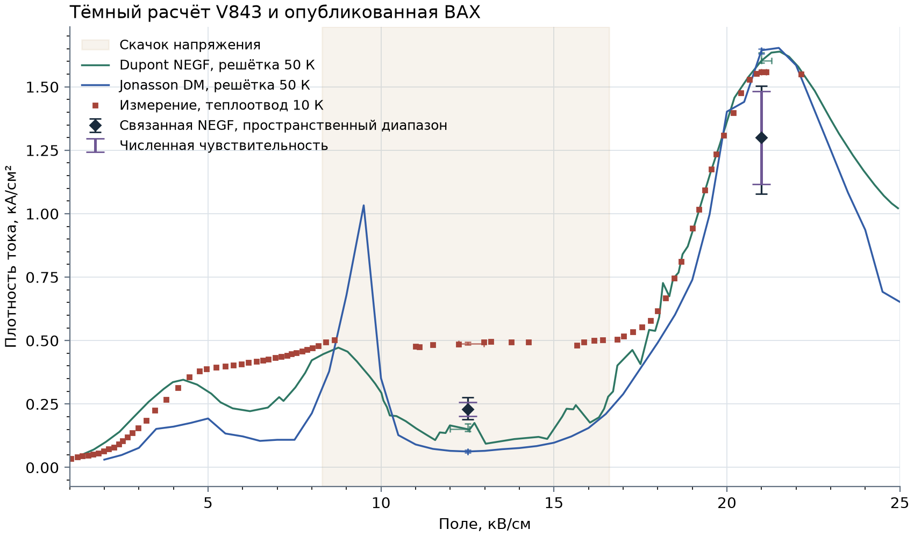

# Dupont V843 при 21 и 12,5 кВ/см

Период 36,16 нм с δ-слоем в первом барьере и целевым листовым зарядом
3,25×10¹⁰ см⁻². На двух точках падение составляет 75,936 и 45,2 мВ.
Решётка и LO-бат установлены на 50 К, транспорт тёмный и периодический,
в основной ветви $U_H=0$. Параметры зон, экранирование и коррелятор
шероховатости зафиксированы в паспорте V843.
[Физический паспорт](v843-passport.md) · [Параметры расчёта](controls/v843-input/dupont/device.toml)

## Ориентиры опубликованной ВАХ

В таблице ток приведён в А/см². В квадратных скобках стоят пределы чтения
кривой, которые включают местный наклон и погрешность шкал. Обводка NEGF
учитывает два прочтения одной опубликованной кривой. Исходные скобки по
полю с точными координатами вершин сохранены отдельно.

| Поле, кВ/см | Dupont NEGF 50 К, вектор / растр | Jonasson DM 50 К | Эксперимент, теплоотвод 10 К |
| --- | ---: | ---: | ---: |
| 21,0 | 1603,08 / 1616,50 [1595,02–1634,12] | 1644,01 [1630,88–1649,39] | 1558,75 [1553,07–1563,79] |
| 12,5 | 150,76 / 154,88 [142,81–173,25] | 62,77 [57,77–67,87] | 488,38 [483,14–493,62], область скачка |

Dupont измерял ВАХ импульсами 250 нс при 1 кГц, в токоуправляемом режиме.
При втором NDR напряжение на период меняется примерно с 30 до 60 мВ
(8,3–16,6 кВ/см). Значение в столбце эксперимента при 12,5 кВ/см
характеризует переход между ветвями. Периодическое решение с равномерным
полем можно здесь сопоставить с опубликованными NEGF50 и DM50, а связь
с экспериментом требует модели доменов и импульсных условий. Температура
решётки во время импульса отдельно не измерена. У Dupont есть участки с
генерацией, при которой транспорт содержит дополнительные процессы.
[Dupont, §V и рис. 9](https://lucris.lub.lu.se/ws/files/2263447/2968920.pdf#page=12) · [Jonasson, рис. 2](https://arxiv.org/pdf/1604.00718#page=8) · [Координаты и скобки](v843-published-points.csv)

## Сопоставление подзон при 21 кВ/см

Сопоставление с рис. 1 по формам и разностям энергий дало порядок
e, l, u, i для первых четырёх состояний центрального блока при $k=0$.
Все формы сравниваются с одной трансляцией −20,09 нм и одним сдвигом
нуля энергии. Средний косинус профилей 0,907, среднеквадратичное
расхождение энергий после сдвига 1,79 мэВ. Следующая по энергиям
перестановка, с обменом u и l, даёт ошибку 8,84 мэВ.
[Данные Fig. 1 и проверка меток](controls/fig1/README.md)

Рис. 8 задаёт $\langle E_k\rangle/k_B$ через 100 пс после включения
поля. Для u, l, e, i опубликованы соответственно 162, 92, 172 и 203 К.
Из рис. 4 используются населённости 1,00, 0,39, 0,60 и 0,33
относительно u. Среднее по этим двум наборам чисел составляет 159 К.
Для собственного расчёта отдельно определяются общий момент физической
ячейки и среднее по четырём сопоставленным подзонам.
[Jonasson, рис. 4 и 8](https://arxiv.org/pdf/1604.00718#page=9) · [Числа из источника](v843-published-subband-moments.csv)

## Сравнение на общем источнике

Для обоих полей использована замороженная после Fath причинная
PV с положительными средними заполнений энергетических ячеек.
На E239×5 после каждого свежего решения оценивались все
физические сечения. Для выбранной карты профиль проверен
независимым GL20. В каждой паре следующий свежий образ ветвился
от того же предыдущего источника. В энергетическом контроле
239→121 применено консервативное перекрытие ячеек с теми же
вершинами, Хартри и физическими границами окна. В радиальном
контроле 5→9 применено перекрытие ячеек в $k^2$ с пересчётом
физических ядер на новых радиусах и проверкой совпадающих узлов.
У эмпирической численной чувствительности берётся максимум
из наблюдаемых сдвигов среднего при двух изменениях сетки,
из отклонений независимого наблюдателя и из дрейфа последних пяти карт.
Пространственный диапазон публикуется отдельно. Такая оценка
характеризует проведённые проверки на конечном состоянии.
[Версии и критерии](method-freeze.toml) · [Радиальная сборка](v843_radial.jl) · [Воспроизведение](reproduce.md)

### Температура и населённости при 21 кВ/см

| Подзона | $T_e$ расчёта, К | Jonasson, К | Населённость относительно u | Jonasson, относительно u |
| --- | ---: | ---: | ---: | ---: |
| u, верхняя лазерная | 140,65 | 162 | 1,000 | 1,00 |
| l, нижняя лазерная | 156,85 | 92 | 0,178 | 0,39 |
| e, экстрактор | 101,70 | 172 | 1,916 | 0,60 |
| i, инжектор | 87,23 | 203 | 0,456 | 0,33 |

Четыре подзоны содержат 98,77% заряда центральной проекции.
Средний момент по четырём подзонам даёт 113,58 К против
159 К, полученных из опубликованных чисел. Для всех
центральных подзон получено 114,33 К, для всей физической ячейки
114,08 К. Радиальный контроль изменил момент всей ячейки до
117,32 К, а энергетический до 116,26 К. Самое заметное
расхождение населённостей у экстрактора, где отношение e/u
равно 1,92 против 0,60. Сопоставление относится к тёмному
несошедшемуся решению с фиксированным Хартри.
[Наблюдаемые V843 при 21 кВ/см](evidence/v843-f21.json) · [Jonasson, рис. 4 и 8](https://arxiv.org/pdf/1604.00718#page=9)

## Ток и численная чувствительность

Обе точки использовали девять связанных периодов по 11 мод,
локальный ранг Q28 и 144 координатных узла. В таблице токи,
отклонения и сдвиги среднего указаны в А/см². Знак обоих швов
дан наружу. Каждый профиль получен на 48-й свежей карте.

| Наблюдаемая | 21 кВ/см | 12,5 кВ/см |
| --- | ---: | ---: |
| Средний внутренний ток | 1299,60 | 229,45 |
| Диапазон по сечениям и швам | 1077,84–1503,04 | 189,90–275,56 |
| Максимальное отклонение и допуск | 221,76 / 13,00 | 46,11 / 2,29 |
| Левый / правый наружный шов | −1464,947 / +1464,418 | −248,345 / +248,320 |
| Сдвиг среднего E239→121 | +78,45 | +8,72 |
| Сдвиг среднего k5→9 | +183,14 | −28,52 |
| Оценка численной чувствительности среднего | 183,14 | 28,52 |
| Максимальный сдвиг профиля E239→121 / k5→9 | 129,10 / 453,38 | 54,91 / 103,32 |
| Дрейф среднего за последние пять карт | 2,65 | 1,38 |
| Максимальная разность независимого и основного профиля | 7,91×10⁻⁹ | 6,39×10⁻⁸ |
| Свежий $r_K$ / независимый $r_{K,Q}$ | 0,03744 / 0,03649 | 0,02193 / 0,02089 |
| Max $r_\Sigma$ с полостями | 0,04660 | 0,03943 |
| Сырой листовой заряд, см⁻² | 3,26363×10¹⁰ | 3,26272×10¹⁰ |
| Сырое $\lambda$ / max спектральный дефект | 1,004194 / 2,81×10⁻⁵ | 1,003914 / 6,01×10⁻¹⁰ |
| $T_e$ всей физической ячейки, К | 114,08 | 120,01 |

На 21 кВ/см среднее ниже векторного NEGF50 на 303,48 А/см²
(18,9%), исходного растрового NEGF50 на 316,90 и DM50 на 344,41.
По отношению к эксперименту разница −259,15 А/см². На 12,5 кВ/см
среднее выше векторного NEGF50 на 78,68 А/см², растрового на
74,57 и DM50 на 166,68. Разность −258,93 А/см² относительно
экспериментальной интерполяции относится к области скачка
напряжения. Знак отклонения от теории меняется между полями.
Оба средних остаются вне огибающих считывания NEGF50 при
испытанных изменениях сетки по одному фактору. Численная
чувствительность и пространственный диапазон относятся к
диагностическим свежим образам. Строгих подтверждений 0 из 48
при каждом поле.
[Машиночитаемые разности и скобки считывания](evidence/v843-comparison.json) · [Все наблюдаемые при 21 кВ/см](evidence/v843-f21.json) · [Все наблюдаемые при 12,5 кВ/см](evidence/v843-f125.json)

Радиальная перестройка сильнее энергетической на обоих полях.
При 12,5 кВ/см она также меняет температуру всей ячейки с
120,01 до 161,13 К. При 21 кВ/см LO-момент велик по мощности,
−907,47 кВт/м², хотя у минимума тока накопленный LO-вклад
составляет −3,27 А/см². Основные накопленные вклады там дают
IFR (−210,08) и примеси (−161,45 А/см²). При 12,5 кВ/см у
минимума преобладают примеси (−37,96) и IFR (−15,83 А/см²).
LO-момент −123,12 кВт/м². Это разные диагностические величины:
первый энергетический момент канала и его вклад в пространственное
изменение числа частиц. В обоих случаях итоговая пространственная
невязка остаётся выше допуска, а поле и перенос энергии на границе
учтены в компактных балансах.
[Разложение по пяти каналам при 21 кВ/см](evidence/v843-f21.json) · [Разложение при 12,5 кВ/см](evidence/v843-f125.json)
