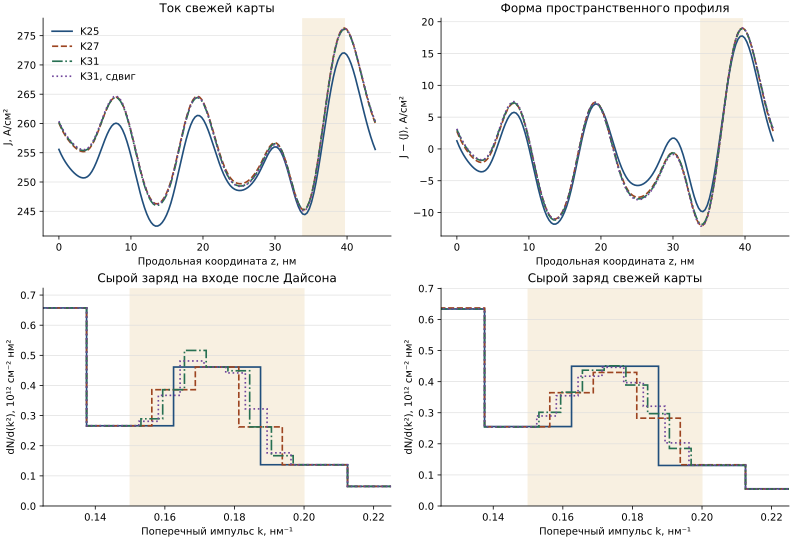

# Локальное радиальное сгущение Fath при 54 мВ

На входе 48-й карты F13 два сгущения внутри 0,15–0,20 нм⁻¹ сохранили
изменения сырого заряда в допуске. Первое изменило профиль тока до
4,57 А/см². На втором шаге разность сократилась до 0,39 А/см²,
при сдвиге новых узлов она составила 0,25 А/см². Перепад около
31 А/см² сохраняется на мелких сетках. Эти измерения ограничивают
сеточную чувствительность свежей карты на данном входе.

[Карточки MyST и связи со свидетельствами](../../docs/research-archive/fath54-local.md) ·
[Воспроизведение](reproduce.md)

## Один вход и три радиальные меры

Во всех руках решается тёмная периодическая задача Fath при 54 мВ на период,
10 К и нулевом Хартри. Используются 481 энергетический узел с шагом
2 мэВ, семь мод на период, Q21, тот же целевой листовой заряд
$3{,}0\times10^{10}$ см⁻² и те же пять каналов рассеяния. Гауссова
шероховатость имеет параметры 0,10 и 8 нм. Экраны LO и примесей
равны 0,20 нм⁻¹. Швы и внутренние сечения лежат на неизменной физической
сетке. [Паспорт Fath](../fath-v843/fath-device.toml) ·
[Замороженный метод](../fath-v843/method-freeze.toml)

Состояние восстановлено до 48-й карты 47 обновлениями от F13(x9)
с долей свежего источника 0,35. SHA-256 входа
`326055b8a545b2401bcdebf5115e97817d7c9e3d4f53245303d339feb5c8372f`
и свежего образа
`d74202bbc508cbd3ae8b3085a750c0caac15816891204fbc689593e1cbd8f9b3`
побитово повторяют ночной прогон. За основу взята полная сетка K25 с
узлом 0,175 нм⁻¹. В K27 добавлены 0,1625 и 0,1875 нм⁻¹,
в K31 дополнительно 0,15625, 0,16875, 0,18125 и 0,19375 нм⁻¹.
Ячейки разделены квадратами середин соседних радиусов и общими
краями 0 и 0,60 нм⁻¹. Все веса положительны. В используемых внутренних
единицах их сумма $9/\pi$. [Ночная сверка](../fath54-stability-night/README.md) ·
[Условия сравнения](protocol.md)

Перенос F13 на каждую сетку выполнен напрямую через доли пересечения
ячеек в $u=k^2$. Сохранение интеграла перенесённой плотности
проверено до Дайсона. Дайсон заново определяет сырую плотность для
перенесённого источника. Далее нормировка пары L/G доводит вход в
оператор столкновений до целевого заряда. Полная свежая карта измерена
до смешивания. На новых узлах причинные константы продолжены аффинно
по $u$ от K25. Парные ядра построены заново штатными физическими
формулами при 32 азимутах и 641 узле $q_z$ для LO. Общие подблоки,
взаимность в весах $w_i w_j$ и сопряжённость переноса проверены
численно. [Воспроизведение](reproduce.md) ·
[Свидетельства](evidence/measurements.json)

## Два шага сгущения

На одной свежей карте локальное сгущение меняет ток сильнее, чем
можно судить по изменению суммарного сырого заряда. Первый шаг
K25→K27 изменил полный профиль до 4,5700 А/см² при допуске 2,5430.
Средний ток вырос на 3,0057 А/см². После вычитания собственного среднего
каждой руки максимальная разность составила 2,5828 А/см² и также
превысила допуск. Второй шаг K27→K31 дал разности 0,3894 А/см² по
полному профилю и 0,3377 А/см² по форме при допуске 2,5730.
[Профили всех 145 сечений](evidence/profiles.csv)

Плотность, перенесённая непосредственно из F13, интегрируется в
3,0009133252×10¹⁰ см⁻² на каждом уровне. На штатном входе в
столкновения коэффициент $a$ умножает электронную заселённость и
доводит её интеграл до 3,0×10¹⁰ см⁻². Добавка из дырочной компоненты
$c$ равна нулю для этих входов. В таблице сырой вход измерен после
Дайсона до этой нормировки. Свежий сырой заряд и ток измерены после
полного обновления источника до смешивания. Ток и перепад даны
в А/см². [Уровни и коэффициенты](evidence/levels.csv)

| Сетка | Сырой вход, 10¹⁰ см⁻² | Коэфф. a | Свежий сырой заряд, 10¹⁰ см⁻² | Среднее J | Макс. отклонение | Перепад | rK | rΣ |
| --- | ---: | ---: | ---: | ---: | ---: | ---: | ---: | ---: |
| K25, полный | 3,217116 | 0,93251223 | 3,035885 | 254,298 | 17,763 | 27,523 | 0,60095 | 1,17941 |
| K27 | 3,209487 | 0,93472892 | 3,032325 | 257,304 | 19,008 | 31,046 | 0,56857 | 1,18171 |
| K31 | 3,233753 | 0,92771448 | 3,032135 | 257,172 | 18,943 | 30,795 | 0,55741 | 1,18358 |
| K31, сдвинутые узлы | 3,229802 | 0,92884955 | 3,031380 | 257,229 | 19,016 | 31,153 | 0,64329 | 1,18303 |

В таблице сравнений изменения заряда выражены в 10⁸ см⁻². Допуск
для заряда равен 3 в этих единицах. Допуск по доле каждой общей моды
равен 0,005. Для токов и заряда полоса после знака ± равна сумме
разностей штатного и независимого наблюдения на двух руках. Для долей
мод использована сумма расхождений GL18/sub2 и GL20/sub3.
[Критерии и сравнения](protocol.md) · [Численные данные](evidence/measurements.json)

| Сравнение | Δ входного заряда | Δ свежего заряда | Δ среднего J | Макс. Δ J | Макс. Δ формы | Δ перепада | Допуск J | Макс. Δ доли моды |
| --- | ---: | ---: | ---: | ---: | ---: | ---: | ---: | ---: |
| K25 → K27 | −0,7629 ± 7,55×10⁻⁸ | −0,3559 ± 5,04×10⁻⁸ | +3,0057 ± 5,60×10⁻⁸ | 4,5700 ± 2,15×10⁻⁷ | 2,5828 ± 1,77×10⁻⁷ | +3,5222 ± 3,13×10⁻⁸ | 2,5430 | 0,000923 ± 1,85×10⁻¹¹ |
| K27 → K31 | +2,4267 ± 1,71×10⁻⁵ | −0,0191 ± 3,05×10⁻⁸ | −0,1319 ± 5,82×10⁻⁸ | 0,3894 ± 2,39×10⁻⁷ | 0,3377 ± 1,81×10⁻⁷ | −0,2505 ± 3,87×10⁻⁸ | 2,5730 | 0,000181 ± 2,59×10⁻¹¹ |
| K31 → сдвиг | −0,3952 ± 1,71×10⁻⁵ | −0,0755 ± 1,74×10⁻⁷ | +0,0569 ± 6,17×10⁻⁸ | 0,2509 ± 1,87×10⁻⁷ | 0,3038 ± 1,31×10⁻⁷ | +0,3580 ± 1,24×10⁻⁸ | 2,5717 | 0,000126 ± 4,58×10⁻¹¹ |
| K31 → последовательный перенос | +0,1618 ± 3,42×10⁻⁵ | −0,0394 ± 3,55×10⁻⁸ | −0,0575 ± 2,32×10⁻⁸ | 0,1322 ± 1,79×10⁻⁷ | 0,0747 ± 1,56×10⁻⁷ | −0,0479 ± 2,02×10⁻⁸ | 2,5717 | 0,000050 ± 2,78×10⁻¹¹ |

Сырой заряд на входе изменился на −0,763 и +2,427 в единицах
10⁸ см⁻². Оба изменения укладываются в инженерный допуск. На
втором шаге свежий заряд в окне 0,15–0,20 нм⁻¹ вырос на 1,714×10⁸ см⁻²,
а вне окна уменьшился на 1,733×10⁸ см⁻². Малость суммарной разности
здесь объясняется компенсацией вкладов. Для попарных разностей
заряды сравнивались после приведения к ячейкам более мелкой или
сдвинутой сетки по пересечениям в $u=k^2$. Вклад внутри окна
получен по доле пересечения каждой целевой ячейки с окном.
[Заряды по ячейкам](evidence/radial-charge.csv) ·
[Разности по ячейкам и окну](evidence/charge-contrasts.json)

## Два контроля мелкой сетки

Первый шаг вышел за допуск по профилю, а на втором шаге среднее
изменилось в обратном направлении. По зарегистрированным условиям
следующим опытом стал сдвиг новых узлов. В двух промежутках K25
внутри окна позиции шести новых точек перенесены с долей 0,25,
0,50 и 0,75 на 0,20, 0,45 и 0,70. Пересчитаны веса, причинные
якоря и физические ядра. Сдвиг изменил весь профиль максимум на
0,2509 А/см², центрированную форму на 0,3038 А/см² и среднее на
+0,0569 А/см². Уменьшение сырого входного заряда составило
3,952×10⁷ см⁻². Все четыре сравнения проходят соответствующие
инженерные допуски. [Измерение сдвига](evidence/measurements.json)

Последовательный путь F13→K25→K31 на той же сетке K31 изменил
сырой входной заряд на +1,618×10⁷ см⁻², среднее на −0,0575 А/см²
и весь профиль максимум на 0,1322 А/см². Таким образом, эффект
смены пути здесь измерен на фиксированном операторе и намного
меньше разности профилей на первом вложенном шаге. Перенос
сохраняет интегральную меру до решения Дайсона. Сглаживание
матричных компонент при возврате на F13 и изменение полного
наблюдаемого на K31 записаны отдельными величинами.
[Измерение пути и обратного переноса](evidence/measurements.json)

## Энергетическое разрешение перераспределения

На каждой из двух мелких сеток выбраны четыре кольца с наибольшим
по модулю перераспределением сырого заряда относительно K25 на
входе или свежем образе. Контрасты разбиты на энергетические
интервалы по 2 мэВ. Например, на свежей K31 при 0,16875 нм⁻¹
и 40–42 мэВ вклад в сырой заряд уменьшается на 1,70×10⁸ см⁻²,
а вклад в средний ток на 2,00 А/см². На свежей сдвинутой сетке
при 0,1925 нм⁻¹ вклад в заряд в −14…−12 мэВ растёт на
1,28×10⁸ см⁻², а вклад в средний ток в 40–42 мэВ растёт на
2,52 А/см². Это контрасты с K25 после приведения к общей кольцевой
мере. Их знаки и размеры совместимы с малыми изменениями полного
профиля между мелкими сетками благодаря компенсации вкладов.
[Спектральный контраст K31](evidence/localization-K31.json) ·
[Спектральный контраст сдвига](evidence/localization-shifted.json)

Замена GL20/sub3 на GL28/sub5 при том же представлении E481 дала
на выбранных кольцах максимум 1,69×10³ см⁻² по сырому заряду,
1,26×10⁻⁵ А/см² по вкладу в средний ток и 2,92×10⁻⁶ А/см² по
вкладу в перепад. Это проверяет интегрирование наблюдаемого при
фиксированном источнике и энергетической сетке. Сходимость
самосогласованного решения по числу энергетических узлов остаётся
открытой. [Радиальные и энергетические разности](evidence/measurements.json)

## Что установлено для сходимости

На проверенном входе второй шаг и два контроля мелкой меры дают
разности полного профиля в пределах 0,39 А/см². Для K31 и
сдвинутой сетки максимальное отклонение от среднего остаётся
18,94 и 19,02 А/см² при пространственном допуске около
2,57 А/см². Перепад на выбранном участке составляет 30,80 и
31,15 А/см². Первое локальное сгущение выявило чувствительность
тока к дискретизации. Дальнейшее сгущение и сдвиг ограничивают
остаточную чувствительность к опробованным узлам при этой
истории и E481. Основная неоднородность сохраняется.

Для свежих карт $r_K=0{,}557$–$0{,}643$, $r_\Sigma=1{,}179$–$1{,}184$
и отклонение сырого заряда свежего образа от целевого превышает 1%.
Критерий стационарности требует три последовательные свежие проверки
с обеими невязками и относительным отклонением заряда ниже $10^{-8}$,
а также допуска по профилю и спектральному весу. Измерения характеризуют
контраст одного отображения и оставляют причину несходимости итераций
открытой. Различающий опыт для сохраняющегося пространственного
перепада — сравнение вложенных 7/8 мод на проверенной мелкой мере и
при сопоставимых свежих невязках. Оно позволит отдельно измерить
проекционный вклад, LO-перенос и гамильтонов поток через те же сечения.
[Строгий критерий](../fath-v843/method-freeze.toml) ·
[Ночной контроль ранга и баланса](../fath54-stability-night/README.md)

## Воспроизведение и ресурсы

Расчёт выполнен Julia Runner на рабочей станции при недоступности общей очереди HTCondor. После двух прерываний
F13 восстановлен повторно и подтверждён побитово. Компактные наблюдения
K25 и K27 сохранены. Для остальных карт использован тот же независимый
наблюдатель Дайсона без вычисления интегралов столкновений в наблюдателе.
На восстановленном K25 профиль, общий и покольцевой заряд и доли мод
совпали с исходным наблюдателем побитово. Сами свежие карты сохраняют
все пять каналов. Финальный запуск занял 2 ч 9 мин 43 с, пик RSS 8,70 ГиБ.
Полные поля оставались в RAM.
[Ресурсы](evidence/resources.json) ·
[Воспроизведение и восстановление](reproduce.md)
