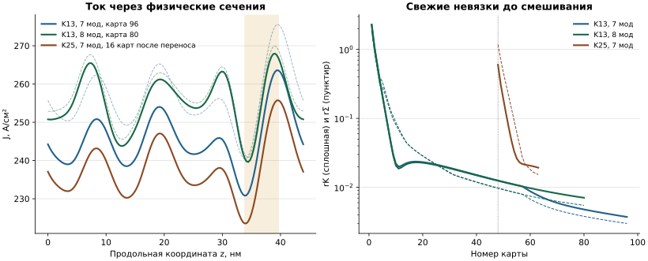

# Устойчивость пространственного тока Fath при 54 мВ

Итерация сняла раннюю часть дефекта. Дальнейшее снижение свежей невязки оставило существенно неоднородный профиль на обеих ранговых сетках. На одном входе радиальное уточнение меняет ответ через повторное решение Дайсона и нормировку. В пространственном балансе основной поздний перепад связан с поднятым LO-членом и меняется при расширении базиса. Строгая стационарность осталась открыта.

Ночной эксперимент 22–23 ноября 2026 года. Тёмная периодическая
задача при 54 мВ на период и 10 К, фиксированный нулевой Хартри.
Источники акустики, примесей, интерфейсной шероховатости, сплава
и LO сохранены. Физические входы включают гауссову шероховатость
0,10 нм с длиной корреляции 8 нм, экраны LO и примесей
0,20 нм⁻¹, положительную энергетическую меру и целевой
листовой заряд $3{,}0\times10^{10}$ см⁻². Окно состоит из 481
энергетического узла с шагом 2 мэВ. Девять связанных периодов и
правила хвостов одинаковы. [Паспорт](../fath-v843/fath-device.toml) ·
[Уравнения](../fath-v843/operators.md) · [Условия сравнения](conditions.md)

| Вариант | Фактически изменённые параметры |
| --- | --- |
| Основная траектория F13(x9) | 7 мод, Q21, 13 колец, доля свежего источника 0,35, затем 1,0 |
| Проверка нелинейного продолжения | Доли 0,35 и 1,0 с одного входа карты 57, по восемь обновлений в каждой ветви |
| Вложенный ранг | 8 мод, Q25, 13 колец, 0,35, общий исходный источник перенесён из Q21 |
| Радиальная пара | 7 мод, Q21, 13→25 колец от одного источника карты 48, 0,35 |
| Локализация колец | Две сетки K24, убран один из добавленных радиусов при неизменных общих узлах K13 |

Загруженное приложение `08e90bc605f0662f1b5559f4c0f0c5a5655ed691`,
Core `c2f45cae21c3e2e4257805ea9c30f9c1d80a7515`. Контрольные
суммы загруженных исходников и архивов совпали. У исходного
F13 SHA-256 поля
`580ef5a026014ce725fbf3ffaae93a08bfd94d51010b6d212a4a9a39fca558d9`.
Q21→Q25 сохранил подблок гамильтониана с относительным отличием
$1{,}24\times10^{-15}$ и общий источник после обратного ограничения
до $5{,}99\times10^{-15}$.
[Воспроизведение](reproduce.md) · [Измерения и отпечатки](evidence/measurements.json)

## Продолжение итерации

Контрольная точка 48 воспроизведена на 7 и 8 модах. Средние
токи 256,387 и 256,929 А/см², максимальные отклонения 19,154
и 16,155 А/см², свежие $r_K=0{,}012579$ и $0{,}012470$.
Ранний семимодовый максимум отклонения упал с 41,197
до 19,154 А/см². Знаковый перепад между фиксированными
сечениями 33,8473 и 39,6410 нм изменился с −13,670
до +35,155 А/см². Глобальное отклонение и знаковая разность
двух сечений отслеживают разные изменения профиля.

С карты 48 по 57 при смешивании 0,35 $r_K$ уменьшился
на 17,5%, а отклонение тока на 0,093 А/см². На карте 57
сделано ветвление с одного источника. После восьми обновлений
при долях 0,35 и 1,0 соответственно получены
$r_K=0{,}008913$ и $0{,}007021$,
$r_\Sigma=0{,}006848$ и $0{,}005461$,
сырой $\lambda-1=2{,}89\times10^{-4}$ и $2{,}55\times10^{-4}$.
Ускоренная рука уменьшила максимум отклонения с 18,990
до 18,857 А/см² относительно параллельной штатной руки.
Разность центрированных профилей составила до 0,201 А/см²,
при средних 255,892 и 254,709 А/см². Нелинейную карту,
нормировку и наблюдателей сохранили. Основная рука продолжила
с долей 1,0.

На 96-й карте основной руки независимый GL20 дал $r_{K,Q}=0,002581$ и согласие профиля до $6{,}99\times10^{-8}$ А/см². От карты 48 свежий $r_K$ уменьшился в 3,38 раза. Максимальная неоднородность уменьшилась на 1,048 А/см² при изменении среднего на -10,916 А/см². На фиксированном отрезке конечный лагированный перепад составляет 32,817 А/см², вклад подстановки источника 0,323 А/см².

| Конечное состояние | Свежий $r_K$ | Max $r_\Sigma$ | Сырой $\lambda-1$ | Max спектральный дефект | Средний $J$ | Диапазон $J$ | Max отклонение |
| --- | ---: | ---: | ---: | ---: | ---: | ---: | ---: |
| 7 мод, K13, карта 96 | $3{,}73\times10^{-3}$ | $3{,}00\times10^{-3}$ | $1{,}64\times10^{-4}$ | $1{,}75\times10^{-5}$ | 245,470 | 230,797–263,576 | 18,106 |
| 8 мод, K13, карта 80 | $7{,}07\times10^{-3}$ | $5{,}49\times10^{-3}$ | $2{,}67\times10^{-4}$ | $9{,}13\times10^{-6}$ | 255,204 | 239,609–267,966 | 15,595 |
| 7 мод, K25, 16 карт после переноса | $1{,}93\times10^{-2}$ | $1{,}54\times10^{-2}$ | $1{,}96\times10^{-3}$ | $4{,}97\times10^{-7}$ | 237,854 | 223,535–255,752 | 17,898 |

Ток в таблице в А/см². Диапазон включает 145 физических сечений с обоими швами. Пунктир на профилях слева отмечает 48-ю карту, пунктир на графике невязок справа — $r_\Sigma$. Для K25 на оси использована сквозная шкала, где 48 соответствует первой карте после переноса.

[Скаляры всех карт](evidence/fresh-maps.csv) · [Профили по сечениям](evidence/profiles.csv)

## Баланс на одном состоянии

Положительный $J$ соответствует потоку электронов вдоль $+z$.
Наружные знаки швов — $-J(0),+J(43{,}91\,\mathrm{нм})$.
Поэтому их почти нулевая сумма проверяет периодический перенос числа
частиц через края, тогда как внутренний перепад проверяет пространственный
баланс. Наблюдатель GL20/sub3 использует полное решение Дайсона и одну
меру для всех членов. На исходном сыром $G$, вычисленном от $s$,
вычитаем локальный член со свежей $\Sigma=F(s)$ из члена с исходной
$\Sigma=s$. Эта подстановка определяет знаковый остаток источника.
Разность токов BDD и $\widetilde H=WS^{-1}HS^{-1}W^\dagger$ даёт
проекционный член в приращениях. Ток $\widetilde H$ получен прямой
суммой по парам узлов, пересекающим сечение. Формулы, знаки и проверки
приведены в [уравнениях](../fath-v843/operators.md) и
[наблюдателе](balance/observe_balance.jl).

На 48-й карте семи мод переход от 33,8473 к 39,6410 нм даёт
$\Delta J=+35{,}318$ А/см² в лагированном балансе. Его составляющие
равны +1,775 от подстановки источника, −1,492 от проекции и +35,035
от пяти каналов. LO даёт +35,967 А/см², остальные каналы суммарно
−0,932 А/см². Максимальная ошибка замыкания по отдельным ячейкам
составила $6{,}0\times 10^{-13}$ А/см². Независимый свежий профиль
от $F(s)$ отличается от штатного максимум на
$7{,}1\times10^{-8}$ А/см². Сумма наружных потоков на свежем
профиле равна +0,000331 А/см². Наиболее резкое изменение внутри
периода приходится на центр ячейки 36,7441 нм внутри донорного
участка GaAs. Последний материальный интерфейс находится на 27,91 нм.

В прямой сумме связей $\widetilde H$ вклад ближайшей связи
в приращение тока на выбранном участке составляет +0,019 А/см²,
дальних внутри периода +9,571, дальних межпериодных +27,219.
Два кольца $k=0{,}10$ и $0{,}20$ нм⁻¹ дают +38,706 А/см² поднятого
LO-члена при −2,739 А/см² от остальных колец. На тех же двух
кольцах антикоммутатор gain−loss даёт +39,452, дисперсионный коммутатор
−0,746 А/см². Полнопериодный LO gain−loss на 48-й карте составляет
примерно −0,120 А/см². Таким образом, большие знаковые слагаемые на
части периода указывают, где искать локальную компенсацию в
проецированной задаче. Интегральный обмен частицами измеряется
отдельным полнопериодным следом.
[Свежие балансы и разложение](evidence/measurements.json)

### Независимая ранговая проверка

| Рука, карта | Свежие $r_K$ / $r_\Sigma$ | Независимый $r_{K,Q}$ | $\Delta J$ | Лаг источника | Проекция | Столкновения | Из них LO |
| --- | --- | ---: | ---: | ---: | ---: | ---: | ---: |
| 7 мод, 48 | 0,012579 / 0,009801 | 0,008699 | +35,318 | +1,775 | −1,492 | +35,035 | +35,967 |
| 8 мод, 48 | 0,012470 / 0,009693 | 0,008637 | +27,430 | +1,848 | +3,682 | +21,900 | +22,468 |
| 7 мод, 64 | 0,007304 / 0,005666 | 0,004844 | +34,398 | +0,844 | −1,467 | +35,021 | +35,914 |
| 8 мод, 80 | 0,007071 / 0,005489 | 0,004709 | +26,341 | +0,843 | +3,681 | +21,817 | +22,380 |
| 7 мод, 96 | 0,003727 / 0,002997 | 0,002581 | +32,817 | +0,323 | −1,384 | +33,878 | +34,595 |

Все приращения в А/см² от 33,8473 к 39,6410 нм. На поздней паре
кинетические и поканальные невязки различаются примерно на 3,3%.
Подстановка источника даёт практически один вклад (+0,844 и +0,843).
Изменению перепада на −8,057 А/см² соответствуют изменения LO
на −13,534, других каналов на +0,329 и проекционного члена
на +5,148 А/см². Проекционная поправка частично компенсирует
изменение столкновительного члена. Прямая сумма дальних связей
между периодами в $\widetilde H$ падает с +27,106 до +7,882 А/см²,
а сумма дальних связей внутри периода растёт с +8,740 до +14,734.
Воспроизведение на одной истории и доле смешивания даёт тот же
знак на карте 48. Поздняя пара использует разные длины траекторий
и доли смешивания при общей фиксированной физической задаче.
На близкой паре свежих карт 65/80 отношения невязок равны
1,007 и 1,005. Вычитание собственных средних оставляет разность
формы до 9,731 А/см² при разности средних 0,495 А/см².
На карте 48 наблюдатели GL20 и штатный расходятся максимум на
$7{,}14\times10^{-8}$ А/см² для 7 мод и $7{,}30\times10^{-9}$
для 8 мод. Переходная архивная траектория F13 из другого
источника на тех же сечениях даёт +32,914 А/см² с лагом
+1,628, проекцией −1,350 и LO +33,188 А/см².
[Свежие измерения](evidence/measurements.json) · [Архивная сверка](evidence/archive-balance.json)

## Одна радиальная пара на общем входе

С карты 48 семимодовой траектории взят один сырой источник $s$.
Все 13 радиусов присутствуют в сетке из 25 колец. На обеих сетках
481 узел энергии и семь аксиальных мод. Сохранены энергия, края
окна, геометрия, Хартри и все физические параметры. Положительные
веса переноса определены пересечением ячеек в $u=k^2$.
Обратный оператор — сопряжённый по весам. Совпадающие
компоненты источника сохранены точно. Максимальная относительная
невязка его взвешенного интеграла по каналам $1{,}67\times10^{-16}$,
заряда перенесённой плотности $1{,}11\times10^{-16}$.
Общие парные ядра совпали до $1{,}08\times10^{-16}$, взвешенная
взаимность каждого ядра замкнулась до $1{,}26\times10^{-15}$.
На новых радиусах использован сохранённый аффинный причинный
якорь. Его наибольшее отличие от продолжения по пересечению
ячеек равно $1{,}91\times10^{-4}$ мэВ.
[Предварительный протокол](transfer/protocol.md) · [Числа](evidence/measurements.json)

После повторного решения Дайсона от перенесённого источника
сырой входной заряд вырос с $3{,}00091\times10^{10}$ до
$3{,}21712\times10^{10}$ см⁻² (+7,20%). Новое кольцо
$k=0{,}175$ нм⁻¹ даёт +$2{,}29145\times10^9$ см⁻²
относительно консервативно продолжённой плотности.
Коэффициент выбранной нормировки lesser изменился с 0,999696
до 0,932512. На свежей карте K25 получены $r_K=0{,}601$,
$r_\Sigma=1{,}179$, $\lambda_{\rm raw}=1{,}01196$.
Нормировка, сохраняющая число, применяется одной формулой
к двум разным входным распределениям.

Независимый GL20 на общей K25 различает
$F_{25}(Ps)$ и $PF_{13}(s)$ на 15,306 А/см² в норме
максимума, при допуске 2,672 А/см². Средние отличаются
на −12,866 А/см². После вычитания средних разность формы
составляет до 2,440 А/см². На общей K13 сравнение
$RF_{25}(Ps)$ с $F_{13}(s)$ даёт до 20,162 А/см²,
включая эффект сглаживания $RP$, который измерен отдельно.
Разность долей по семи центральным состояниям на общей K25
достигает 0,00339. В том же сравнении на K13 максимум 0,00584.
Взвешенная относительная норма полей LO greater/lesser в
коммутаторе равна 0,451/0,246.

На общей тонкой сетке промежуточный опыт применяет $S_{25}$
к консервативно перенесённому нормированному $G_{13}$.
Замена только столкновительной квадратуры
$S_{25}(P\mathcal N_{13})-P S_{13}(\mathcal N_{13})$
меняет профиль на 0,582 А/см², среднее на −0,398 А/см².
Замена на заново решённое и нормированное $\mathcal N_{25}$
даёт соответственно 15,085 и −12,468 А/см². Телескопическое
разложение замыкается на каждом сечении. Пики взвешенного дефекта
LO lesser и greater приходятся на (−64 мэВ, 0,150 нм⁻¹)
и (+234 мэВ, 0,525 нм⁻¹). В этих двух ячейках прямые и
обратные события совпадают в весах до $3{,}8\times10^{-17}$
с относительным воспроизведением производственного источника
до $3{,}1\times10^{-16}$. У обеих пар покрытие энергетического
окна полное. Таким образом, в этом опыте крупный эффект даёт
реакция Дайсона и нормировки на новые кольца, прежде всего
на перераспределение сырого заряда. Проверка событий локальна
для двух выбранных ячеек.
[Разложение коммутатора и проверка событий](evidence/measurements.json)

Тонкая рука прошла 16 карт с долей свежего источника 0,35.
$r_K$ упал с 0,601 до 0,01930, $r_\Sigma$ — с 1,179 до
0,01536. При этом максимальное отклонение тока изменилось
с 17,763 до 17,898 А/см². Полный независимый GL20 подтвердил
конечный профиль в пределах $5{,}04\times10^{-8}$ А/см² и
дал $r_{K,Q}=0{,}01447$. Переходная пара с близкими
невязками — карта 31 K13 и карта 16 после переноса K25.
Отношения двух свежих невязок равны 1,028 и 1,025,
а $\lambda_{\rm raw}-1$ составляет соответственно
$4{,}47\times10^{-5}$ и $1{,}96\times10^{-3}$. Средние
токи K13 и K25 равны 252,597 и 237,854 А/см². Максимальная
разность профилей 16,382 А/см² при разности центрированных
профилей 3,090 А/см². Эта пара ограничивает чувствительность
в измеренных состояниях на двух сетках с разной историей.
Предел стационарного тока остаётся открытым.

### Проверка двух радиальных интервалов

Состояние и свежий источник карты 48 независимо восстановлены
в RAM с побитовым совпадением SHA-256. В двух руках K24 из
K25 убрано по одному новому кольцу. Оставшиеся строки переноса
совпадают с K25. Положительные веса в каждом случае
пересчитаны, а физические парные ядра сохранены на общих узлах.

| Убранное кольцо, нм⁻¹ | Сырой входной заряд, см⁻² | Свежие $r_K$ / $r_\Sigma$ | Средний $J$, А/см² | Max разность с K25, А/см² | Max разность формы с K25, А/см² |
| --- | ---: | --- | ---: | ---: | ---: |
| 0,175 | $2{,}98797\times10^{10}$ | 0,56486 / 1,16050 | 250,090 | 9,225 | 5,468 |
| 0,275 | $3{,}21860\times10^{10}$ | 0,60054 / 1,00486 | 259,114 | 5,935 | 1,398 |

Удаление $k=0{,}175$ устраняет прирост сырого входного заряда
относительно K13 до остатка −0,43%. Контрольное удаление
$k=0{,}275$ меняет входной заряд K25 примерно на +0,046%.
Оно всё же сдвигает средний свежий ток на +4,815 А/см²,
при меньшем эффекте на центрированную форму. Поэтому локализация
прироста сырого заряда и чувствительность всей свежей карты
дают разные ограничения. Профили K24 относятся к одному
отображению после переноса.
[Протокол локализации](transfer/node-omission.md) · [Числа](evidence/measurements.json)

Независимые GL20-профили обеих рук согласуются со штатными до $2{,}25\times10^{-7}$ А/см². Разность долей центральных состояний относительно K25 достигает 0,00533 для 0,175 нм⁻¹ и 0,00031 для 0,275 нм⁻¹.

## Границы вывода

Три последовательные карты должны удовлетворять
$r_K,r_\Sigma,|\lambda-1|<10^{-8}$, спектральному порогу $10^{-3}$
и плоскостности тока в пределах $\max(1\,\mathrm{А/см^2},
0{,}01|\bar J|)$. Все конечные руки соблюдают спектральный порог.
Свежие невязки, сырой заряд и пространственные отклонения остаются
выше допусков. Для предела долей заселённостей и стационарного тока
на двух сетках требуется продолжение. По этой же причине тест V843
оставлен за рамками полученного результата. F25 с 959 энергетическими
узлами имеет собственную историю и не входит в радиальную пару.

Сопоставление с литературой требует численно принятого тёмного
решения на той же геометрии, температуре и при том же напряжении.
Изолированные уровни и туннельные связи Fath служат отдельным
тестом гамильтониана. [Критерии](../fath-v843/method-freeze.toml) ·
[Библиотека проверок](../historical/literature/audit-preparation/evidence-index.md#fath54-v843)

Следующий опыт — уточнить радиальную меру только в интервале
$k=0{,}15$–$0{,}20$ нм⁻¹ и повторить карту с тем же восстановимым
источником. Сопоставление сырого заряда и центрированного профиля
при двух вложенных локальных уточнениях проверит устойчивость
обнаруженной чувствительности к положению узлов.

Измерения выполнены через Runner и Core в RAM, в пределах 13
вычислительных потоков, включая GC и BLAS. Короткая штатная
карта заняла 134 с и 3,77 ГиБ. Старт проверки K24 один раз
завершился до вычислений из-за неверного имени функции чтения
YAML. Повтор с исправленным чтением восстановил побитово
идентичное состояние. Размеры выхода и коды завершения
приведены в квитанциях. [Ресурсы](evidence/resources.json)
